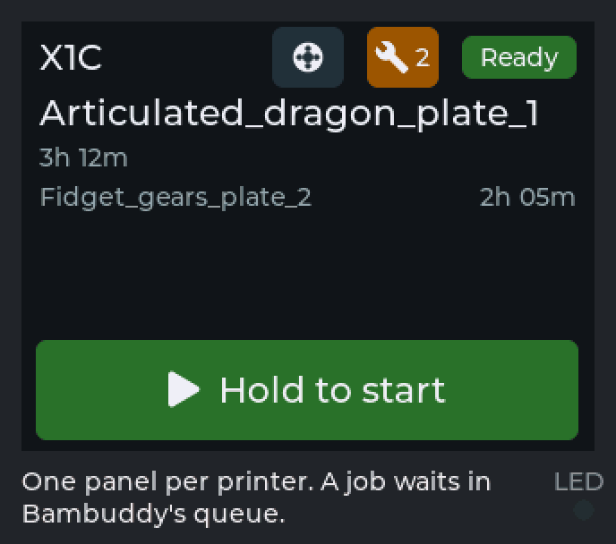

A small touch panel that sits next to a printer and shows what Bambuddy knows about it, with the few actions you want while standing there. One panel per printer. It runs on the inexpensive ESP32-2432S028R ("Cheap Yellow Display") and talks only to your Bambuddy server over WiFi, never to the printer or to any cloud. Available status fields and controls depend on the printer and Bambuddy version.

The screen follows the printer's state: progress, time left, layer and temperatures while printing; the *Ask for outcome* question with a thumbs up / thumbs down when a print finishes; **Plate is clear** when Bambuddy waits for it; the next queued jobs, and why the first one is waiting, when idle. Start, Stop, Resume queue and Plate is clear require a 1.5-second hold. Pause and Resume take one tap.

*A minute with the panel, recorded from its desktop simulator with a made-up printer.*

**Author:** [loidolt](https://github.com/loidolt)
**Repository:** [github.com/loidolt/bambuddy-panel](https://github.com/loidolt/bambuddy-panel)
**Documentation:** [Panel guides](https://github.com/loidolt/bambuddy-panel/tree/main/docs)
**Status:** Independent community project

!!! note "Tested hardware"

    The panel runs on the ESP32-2432S028R with the ST7789 display. The build profiles for the other boards compile but have not been flashed yet; reports from those boards are welcome.

---

## What it does

- **Print controls** &mdash; pause, resume and stop (hold).
- **Plate is clear** (hold), available when Bambuddy requires confirmation. Clearing the plate lets the scheduler consider the next job.
- **Outcome question** &mdash; thumbs up, thumbs down or skip, asked before the plate is released.
- **Queue** &mdash; start the next job staged for this printer (hold), resume a queue held after a failed print (hold).
- **Errors** &mdash; shows the HMS error's text and clears it.
- **Filament** &mdash; the printer's slots with the inventory spool assigned to each and what is left on it; assign or remove a spool (hold). Bambuddy's own inventory, not Spoolman.
- **Maintenance** &mdash; the printer's tasks, most urgent first; mark one done (hold).
- **Status LED** &mdash; blinks when someone should come over: outcome question, plate to clear, paused, error, Bambuddy unreachable.

---

## What you need

- An ESP32-2432S028R ("Cheap Yellow Display": ESP32, 2.8" 320x240 resistive touchscreen, no PSRAM) and a 5 V USB supply. Build profiles also exist for its 2.4", 3.2" and 3.5" relatives, the Guition JC2432W328C and the WT32-SC01; those have only been compiled.
- A data-capable USB cable for flashing.
- A Bambuddy [API key](../features/api-keys.md). The settings page suggests up to 16 printers and also accepts a printer id.

---

## Setup

1. Flash a firmware file from the [releases page](https://github.com/loidolt/bambuddy-panel/releases) with `esptool`, or build with PlatformIO. [Get started](https://github.com/loidolt/bambuddy-panel/blob/main/docs/get-started.md) has both, and the rest of the setup in full.
2. Create an API key for the panel with **Read Status**, **Control Printer** and **Manage Queue**; optionally **Manage Archives** (outcome question), **Manage Maintenance** and **Manage Inventory**. An access denial can also depend on the key owner’s permissions.
3. Power the panel. It asks for four taps to calibrate the touch, then shows a QR code for its setup network, where you choose your WiFi.
4. Once on your WiFi it shows a second QR code for its settings page. Enter the Bambuddy URL and the API key, pick the printer from the list, save.

Later releases go on without USB: the settings page takes the new firmware file, and refuses one built for another board.

---

## How it talks to Bambuddy

Bambuddy Panel uses Bambuddy's [REST API](../reference/api.md), authenticated with an [API key](../features/api-keys.md) in the `X-API-Key` header. It polls the printer's status, its queue and its last archive in a round with a four-second wait after completion, and maintenance, settings and spool assignments once a minute. Every route it calls is part of Bambuddy's `/api/v1` REST API as published in its OpenAPI schema (checked against 1.3.2); none is an internal endpoint. The documentation lists [every request it makes](https://github.com/loidolt/bambuddy-panel/blob/main/docs/api.md).

The connection is plain HTTP on your LAN, and the key is stored unencrypted in the panel's flash. Give the key only the permissions above and delete it in Bambuddy if a panel goes missing.

---

## Support

For panel issues, feature requests and questions, visit the [panel project on GitHub](https://github.com/loidolt/bambuddy-panel/issues).

For Bambuddy-side questions (API key setup, permissions, etc.), the [Discord](https://discord.gg/aFS3ZfScHM) is the right place to ask.
