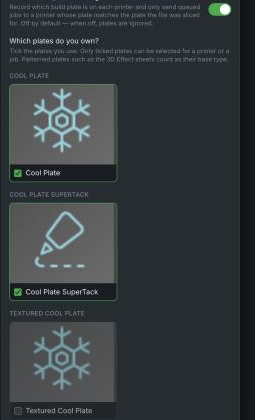
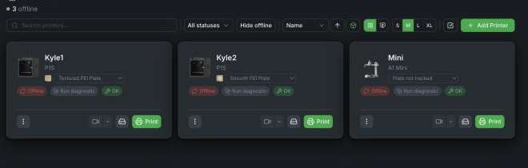
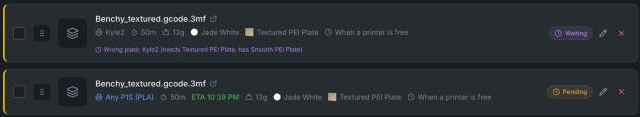

# Build Plates

A sliced file is made for one kind of build plate. The slicer bakes the bed temperature and first-layer settings for that plate into the G-code, so a job sliced for a Textured PEI plate should not start on a printer that has a Cool Plate fitted.

With build plate tracking on, Bambuddy records which plate is on each printer and the print queue only sends a job to a printer whose plate matches the plate the file was sliced for. A job that has no matching printer waits in the queue and says which plate it needs.

Tracking is **off by default**. While it is off, plates are ignored everywhere and the queue behaves exactly as before.

## Turn on tracking

1. Open **Settings → Workflow → Queue & Dispatch**.
2. In the **Build Plates** card, turn on **Enable build plate tracking**.
3. Under **Which plates do you own?**, tick the plates you use. Only ticked plates can be chosen for a printer or a job.

{ .screenshot }

Plates are grouped by the plate type the slicer knows them as:

| Plate type | Slicer names it matches |
|------------|-------------------------|
| Cool Plate | Cool Plate, PC Plate, Smooth Cool Plate |
| Textured Cool Plate | Textured Cool Plate (OrcaSlicer) |
| Cool Plate SuperTack | Supertack Plate |
| Engineering Plate | Engineering Plate |
| Smooth PEI / High Temp Plate | High Temp Plate, Smooth PEI Plate |
| Textured PEI Plate | Textured PEI Plate, PEI Plate |

Patterned plates such as the Bambu **3D Effect** sheets are listed under the plate type they are sliced as (Smooth PEI / High Temp Plate), so a file sliced for a smooth PEI plate can print on any of them.

### Add your own plate

Click **Add custom plate** for a third-party or custom plate and fill in:

- **Name** — how the plate appears on printer cards and in the print dialog, for example *Gold PEI*.
- **Slicer plate type** — the plate type you select in the slicer when you print on this plate. This decides which files can print on it.
- **Pattern** (optional) — shown under the name, for example *Carbon Fiber*.
- **Photo URL** (optional) — an image shown on the plate's tile.

A custom plate can be deleted with the bin icon on its tile. Printers that had it fitted become **not tracked**, and queued jobs that asked for it accept any plate of the same type instead.

Unticking a plate that is fitted to a printer, or that queued jobs are waiting for, asks for confirmation first. The plate is hidden from new jobs; jobs already waiting for it keep waiting.

## Set the plate on each printer

With tracking on, every printer card shows the plate that is fitted. Pick the plate from the list whenever you swap it.

{ .screenshot }

**Plate not tracked** means Bambuddy does not know which plate is on the printer. Such a printer accepts any job, as it did before tracking was turned on, so you can start tracking one printer at a time.

Changing the plate while the printer is printing asks for confirmation. Only change it once the plate has really been swapped: as soon as the current print finishes, the queue sends the next job that fits the plate you selected.

!!! note "Turning tracking back on"
    Plates are often swapped while tracking is off, so the plates recorded before it was turned off may be wrong. When you turn tracking back on, every printer is reset to **Plate not tracked**. Set the plate on each printer card again.

## Choose the plate for a job

When you add a job to the queue (or edit a queued job), the print dialog has a **Build plate** choice, filled in from the file:

{ .screenshot }

| Option | The job runs on |
|--------|-----------------|
| **Any *&lt;type&gt;*** (the default) | Any printer with a plate of the type the file was sliced for. Shown as **Plate from file** until the file's plate type has been read. |
| A specific plate, for example *3D Effect – Carbon Fiber* | Only a printer with that exact plate fitted. Useful when the plate's pattern matters to the print. |
| **Any plate (ignore plate)** | Any printer, whatever plate it has. Use it for a file you know prints fine on other plates. |

For a multi-plate 3MF, the plate type is read for the plate you selected, not for the first plate in the file.

Jobs added without the dialog (from the Virtual Printer, webhooks, slicer pipelines or a library bulk add) get their plate type from the file the first time the queue looks at them. A file whose plate type cannot be read never blocks a job: it is treated as **Any plate**.

## How the queue uses plates

- **Jobs for a specific printer** wait while that printer has the wrong plate. The queue card says **Wrong plate** and names the plate the job needs and the plate that is fitted.
- **Jobs for any printer of a model** go to a printer of that model whose plate fits. Printers with the wrong plate are skipped, and if none fits the card lists each printer and its plate.
- A printer with the wrong plate is **not** treated as busy. A later job for the plate that is fitted can still run on it, so a queue holding jobs for different plates keeps the printers working.
- A printer with the wrong plate is not switched on by its smart plug for that job.
- The plate is checked once more right before the job is sent, in case it was changed in the meantime.

{ .screenshot }

Once you swap the plate and set it on the printer card, waiting jobs for that plate start on the next queue check.

The queue card also shows the plate a job needs next to the file's details. While tracking is on and the job asked for a specific plate, the card names that plate.

## Permissions

With [authentication](authentication.md) enabled:

| Action | Permission |
|--------|------------|
| See plates, the plate on each printer and a job's plate | `printers:read` |
| Tick plates, add, edit or delete custom plates, turn tracking on or off | `settings:update` |
| Change the plate fitted to a printer | `printers:control` |

## API

| Method | Endpoint | Description |
|--------|----------|-------------|
| `GET` | `/api/v1/build-plates` | All plates, with the printers each is fitted to and how many pending jobs asked for it |
| `GET` | `/api/v1/build-plates/bed-types` | The plate types a plate can belong to |
| `POST` | `/api/v1/build-plates` | Add a custom plate |
| `PATCH` | `/api/v1/build-plates/{id}` | Edit a plate, or tick and untick it (`enabled`) |
| `DELETE` | `/api/v1/build-plates/{id}` | Delete a custom plate |
| `PUT` | `/api/v1/printers/{id}/installed-plate` | Set the plate fitted to a printer (`{"plate_id": 6}`, or `null` for not tracked) |

Queue items carry `required_plate_type` (a plate type, or `any`) and `required_plate_id` (a specific plate, or `null`), and printers carry `installed_plate_id`.
