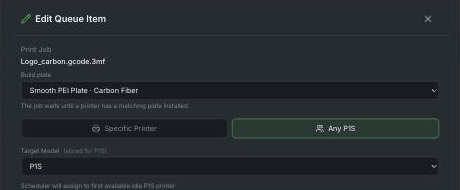

# Build Plates

A sliced file is made for one kind of build plate. The slicer bakes the bed temperature and first-layer settings for that plate into the G-code, so a job sliced for a Textured PEI plate should not start on a printer that has a Cool Plate fitted.

With build plate tracking on, Bambuddy records which plate is on each printer and the print queue only sends a job to a printer whose plate matches the plate the file was sliced for. A job that has no matching printer waits in the queue and says which plate it needs.

Tracking is **off by default**. While it is off, plates are ignored everywhere and the queue behaves exactly as before.

## Turn on tracking

1. Open **Settings → Workflow → Queue & Dispatch**.
2. In the **Build Plates** card, turn on **Enable build plate tracking**.
3. Under **Which plates do you own?**, tick the plate types you use. Only ticked plates are offered on printer cards and in the print dialog, so someone with two plates sees two.

The first time, the types you have already printed on (from your print archive) start ticked. With no print history yet, every type starts ticked.

{ .screenshot }

A plate type is what the slicer calls the plate, so the list is fixed:

| Plate type | Slicer names it matches |
|------------|-------------------------|
| Cool Plate | Cool Plate, PC Plate, Smooth Cool Plate |
| Textured Cool Plate | Textured Cool Plate (OrcaSlicer) |
| Cool Plate SuperTack | Supertack Plate |
| Engineering Plate | Engineering Plate |
| Smooth PEI Plate | High Temp Plate, Smooth PEI Plate |
| Textured PEI Plate | Textured PEI Plate, PEI Plate |

### Patterns

Some plates are a plate type with a pattern on top, such as the Bambu **3D Effect** sheets (Carbon Fiber, Starry, Diamond, Galaxy), which are all sliced as Smooth PEI. If the pattern matters to a print, add it under its type:

1. Click **Add pattern** under the plate type, for example **Smooth PEI Plate**.
2. Type the name, or pick one of the suggestions, and click **Add**.

The plate then appears as **Smooth PEI Plate · Carbon Fiber**. A patterned plate is still a plate of its type, so it takes any job sliced for that type; only a job that asks for the pattern needs it. Any name works, so third-party textured sheets can be added the same way.

Unticking a type only hides it from the plate lists. Printers that have it fitted keep it, and queued jobs that need it keep waiting for it, so the settings page asks first when the type is in use.

Removing a pattern asks first when it is in use. Printers that had it fitted keep the plate type without the pattern, and queued jobs that asked for it accept any plate of that type.

## Set the plate on each printer

With tracking on, every printer card shows the plate that is fitted. Pick the plate from the list whenever you swap it.

{ .screenshot }

**Plate not tracked** means Bambuddy does not know which plate is on the printer. Such a printer accepts any job, as it did before tracking was turned on, so you can start tracking one printer at a time.

Changing the plate while the printer is printing asks for confirmation. Only change it once the plate has really been swapped: as soon as the current print finishes, the queue sends the next job that fits the plate you selected.

!!! note "Turning tracking back on"
    Plates are often swapped while tracking is off, so the plates recorded before it was turned off may be wrong. When you turn tracking back on, every printer is reset to **Plate not tracked**. Set the plate on each printer card again.

## Choose the plate for a job

When you add a job to the queue (or edit a queued job), the print dialog has a **Build plate** choice, filled in from the file:

{ .screenshot }

| Option | The job runs on |
|--------|-----------------|
| **Any *&lt;type&gt;*** (the default) | Any printer with a plate of the type the file was sliced for, with or without a pattern. Shown as **Plate from file** until the file's plate type has been read. |
| A pattern, for example **Smooth PEI Plate · Carbon Fiber** | Only a printer with that plate and pattern fitted. Only the patterns of the file's plate type are offered. |
| **Any plate (ignore plate)** | Any printer, whatever plate it has. Use it for a file you know prints fine on other plates. |

For a multi-plate 3MF, the plate type is read for the plate you selected, not for the first plate in the file. The file decides the plate type even if you have unticked that type: the job then waits until a printer has that plate recorded.

Jobs added without the dialog (from the Virtual Printer, webhooks, slicer pipelines or a library bulk add) get their plate type from the file the first time the queue looks at them. A file whose plate type cannot be read never blocks a job: it is treated as **Any plate**.

## How the queue uses plates

- **Jobs for a specific printer** wait while that printer has the wrong plate. The queue card says **Wrong plate** and names the plate the job needs and the plate that is fitted.
- **Jobs for any printer of a model** go to a printer of that model whose plate fits. Printers with the wrong plate are skipped, and if none fits the card lists each printer and its plate.
- A printer with the wrong plate is **not** treated as busy. A later job for the plate that is fitted can still run on it, so a queue holding jobs for different plates keeps the printers working.
- A printer with the wrong plate is not switched on by its smart plug for that job.
- The plate is checked once more right before the job is sent, in case it was changed in the meantime.

{ .screenshot }

Once you swap the plate and set it on the printer card, waiting jobs for that plate start on the next queue check.

The queue card shows the plate a job needs next to the file's details, followed by the pattern when the job asked for one.

## Permissions

With [authentication](authentication.md) enabled:

| Action | Permission |
|--------|------------|
| See the plates, the plate on each printer and a job's plate | `printers:read` |
| Tick plate types, add or remove patterns, turn tracking on or off | `settings:update` |
| Change the plate fitted to a printer | `printers:control` |

## API

| Method | Endpoint | Description |
|--------|----------|-------------|
| `GET` | `/api/v1/build-plates` | Every plate type (with whether it is owned), the patterns, and where each is fitted or needed |
| `PUT` | `/api/v1/build-plates` | Replace the owned types and patterns: `{"types": ["smooth_pei"], "patterns": [{"base_type": "smooth_pei", "name": "Carbon Fiber"}]}` |
| `PUT` | `/api/v1/printers/{id}/installed-plate` | Set the plate fitted to a printer: `{"plate_type": "smooth_pei", "pattern": "Carbon Fiber"}`, or `{"plate_type": null}` for not tracked |

Printers carry `installed_plate_type` and `installed_plate_pattern`. Queue items carry `required_plate_type` (a plate type, or `any`) and `required_plate_pattern` (a pattern, or `null` for any plate of the type).
