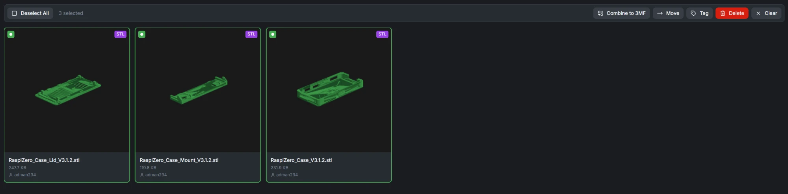
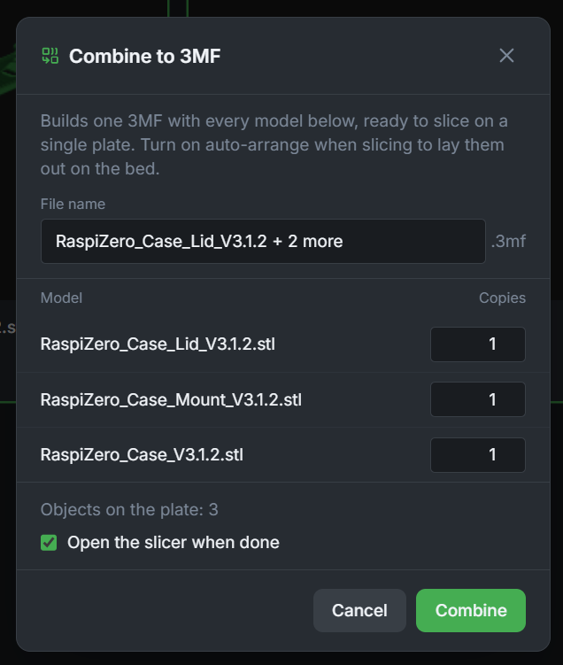
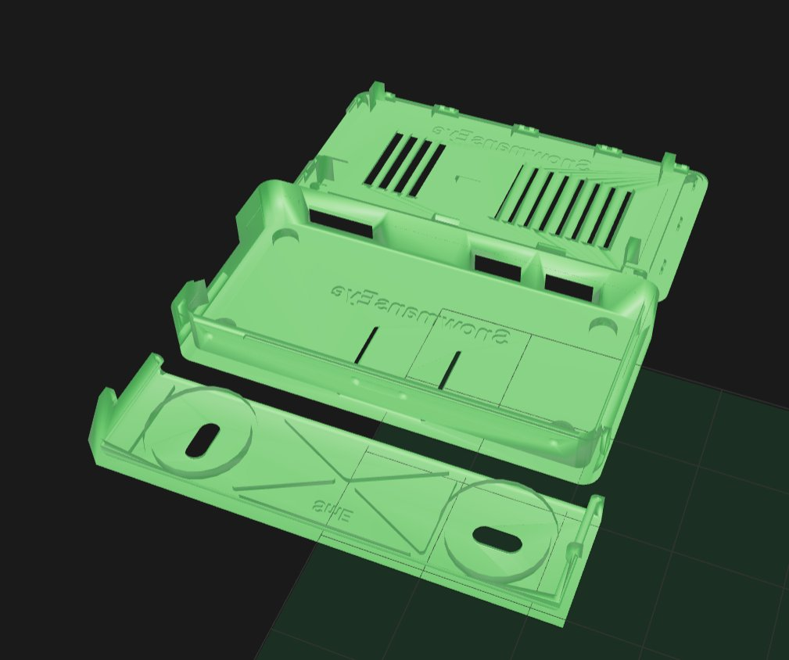
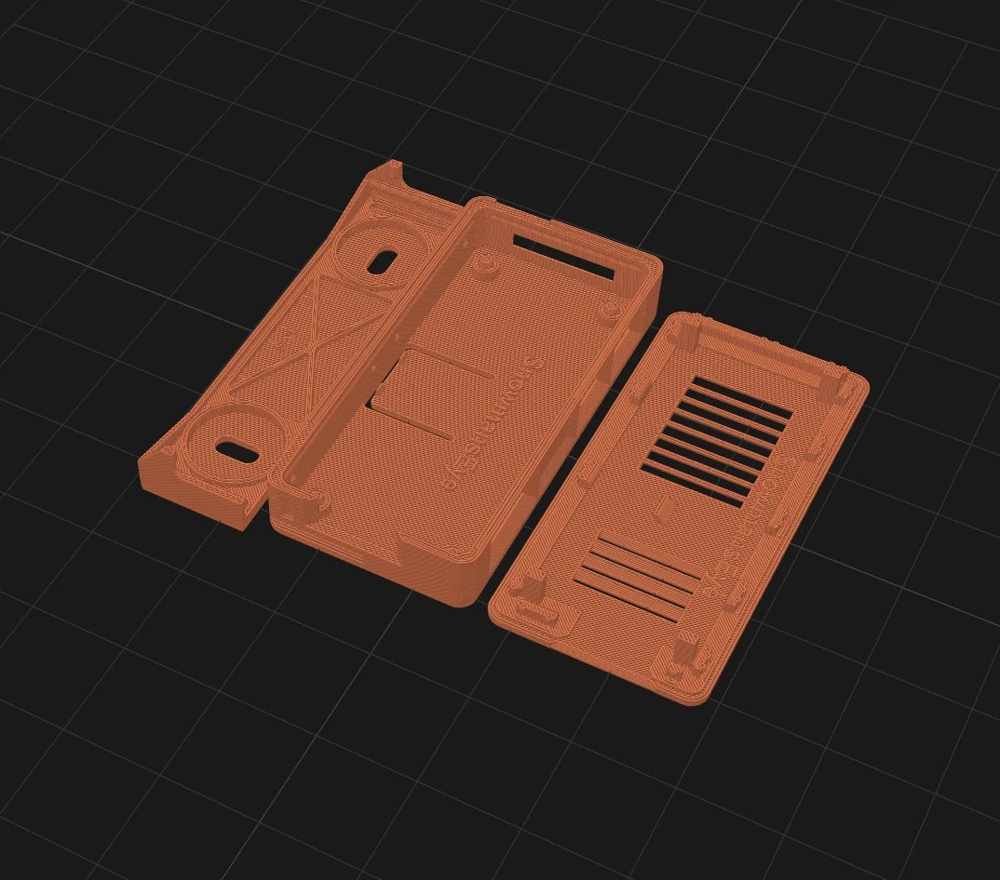

# File Manager

Browse, download, and manage files in your local Bambuddy library.

---

## :material-folder: Overview

The File Manager lets you:

- **Browse** files in your local library
- **Mount external folders** from NAS, USB, or network shares
- **Upload** files including ZIP archives
- **Download** files to your computer
- **Rename** files and folders
- **Delete** unwanted files
- **View** file details and metadata
- **Print** sliced files with ASAP, Queue, or Schedule
- **Link** folders to projects or archives

---

## :material-folder-network: External Folders

External folders let you surface a host directory (a NAS mount, a USB
drive, a local prints folder) inside Bambuddy's library without
copying any files. They appear alongside the managed library and can be
browsed, slice-previewed, and printed from like any other folder.

### Operator configuration

As of v0.2.5b1 (GHSA-r2qv follow-up) the feature is **opt-in for
operators**. The `BAMBUDDY_EXTERNAL_ROOTS` environment variable
controls which host paths users are permitted to register as external
folders:

| Setting | Effect |
|---------|--------|
| `BAMBUDDY_EXTERNAL_ROOTS=` (empty / unset) | Feature disabled — `POST /api/v1/library/folders/external` returns HTTP 400 with a hint pointing at this variable. |
| `BAMBUDDY_EXTERNAL_ROOTS=/mnt/nas/prints` | Single allowed root — users can register any path inside `/mnt/nas/prints`. |
| `BAMBUDDY_EXTERNAL_ROOTS=/mnt/nas/prints:/srv/library` | Two allowed roots — colon-separated absolute paths. |

In Docker, also bind-mount the host path into the container at the
same path you list in `BAMBUDDY_EXTERNAL_ROOTS` — see the
[Docker → External library folders](../getting-started/docker.md#external-library-folders-bambuddy_external_roots)
tip for a complete example. Read-only (`:ro`) bind mounts are
recommended unless you want users uploading files back into the host
share.

### Registering an external folder

With the env var set, any user with `Settings → Update` permission can:

1. Open **File Manager** → **Add external folder** (top right).
2. Enter a name and the absolute path inside the container (must be
   within `BAMBUDDY_EXTERNAL_ROOTS`).
3. Choose **Read-only** to prevent uploads to this folder (recommended
   for shared NAS mounts), or leave unchecked for read/write.
4. Click **Add**. Bambuddy scans the folder and surfaces 3MFs, STLs,
   gcode, and image files.

The folder appears in the sidebar with the :material-folder-network:
icon and persists across restarts. Deleting an external folder from
the UI only removes Bambuddy's index entry — the host files are not
touched.

### External folders security stance

The pre-v0.2.5b1 implementation used a **denylist** of system
directories (`/proc`, `/sys`, `/dev`, ...). Everything else passed,
including `/data` (Bambuddy's own data directory containing other
users' archives), `/root`, arbitrary NFS/SMB mounts the operator did
not realise the container could see, and the Bambuddy log directory.
That was the same fail-open-on-growth shape as the
[GHSA-r2qv-8222-hqg3](https://github.com/maziggy/bambuddy/security/advisories/GHSA-r2qv-8222-hqg3)
finding on the permission system: an attacker did not need a CVE, the
codebase grew into the exposure on its own as new file extensions
became scannable.

The v0.2.5b1 fix replaces the denylist with the
`BAMBUDDY_EXTERNAL_ROOTS` allowlist. Bambuddy's own data / log /
static / archive directories are hardcode-rejected even if the
operator over-broadens the allowlist (e.g. accidentally sets `/` for
testing), so configuration mistakes cannot expose internal state. The
route is additionally gated on `SETTINGS_UPDATE` (was `LIBRARY_UPLOAD`)
since registering a host filesystem path is an operator-class
capability that crosses user boundaries.

If an existing deployment used the feature before v0.2.5b1, the
external folders remain in the database after upgrade but **stop
working** until the operator sets `BAMBUDDY_EXTERNAL_ROOTS` to cover
the paths in use. The UI surfaces a clear error pointing at the
variable.

---

## :material-folder-open: Accessing File Manager

1. Click **File Manager** in the sidebar
2. Or navigate to `/file-manager` in the URL

---

## :material-file-tree: File Browser

### Library Structure

Your library contains uploaded and archived files:

- Folders for organizing files
- 3MF and sliced gcode files
- Linked folders connected to projects/archives

### Folder Ownership & Sharing

Every folder has an owner, the user who made it. What you see of the folder tree depends on your library permission:

- **`library:read_all`** (View all library files) — every folder.
- **`library:read_own`** (View own library files) — your own folders, folders **shared with everyone**, folders that hold one of your files, and the folders above those so you can reach them. Other users' folders are hidden.

A folder's file count and last-activity time only count the files you can see.

**Sharing a folder.** Users with `library:update_all` can open a folder's menu (:material-dots-vertical:) and choose **Share with everyone**; **Stop sharing** undoes it. A shared folder shows a :material-account-multiple: icon. Everyone sees it and can add files and subfolders to it, but renaming and deleting it stays with its owner and admins. Sharing applies to that one folder: a folder inside it is shared only if it is marked too.

**Where you can add files.** With `library:read_own` you can upload, extract ZIPs, move files, create subfolders and import from MakerWorld or Manyfold into your own folders, shared folders and the top level. In a folder you only pass through (one above your own files), **Upload** and **New Folder** are disabled, and the Move dialog greys it out.

!!! example "A classroom"
    The teacher creates **Class Project** and shares it. Each student sees **Class Project** and their own folders, and nothing of the other students. A student's subfolder inside **Class Project** belongs to the student and stays private to them, so the teacher sees everyone's work while students only see their own.

**Folders from before this feature.** On upgrade, a folder whose files (subfolders and trashed files included) all belong to one user becomes that user's folder, and an empty folder inside it goes with it. Every other existing folder (empty, used by several people, linked to a project or archive, external, or the **MakerWorld** and **Manyfold** import folders) is shared, so it stays visible as before. Folders created while authentication is off, and newly linked external folders, are shared too, so turning authentication on later hides nothing; an admin can stop sharing them.

### File Information

Each file shows:

- Filename
- Size
- File type icon
- Print count (if printed before)
- Uploaded by (when authentication is enabled)
- Last-modified date (optional — toggle it on from the sort controls; see [Sorting](#sorting))

---

## :material-view-column: Column View

Next to **Grid** and **List**, the view switcher in the File Manager header offers **Column view** — Miller columns, as in the macOS Finder or a file dialog. It shows where you are in the folder hierarchy and lets you walk up and down it without going back to the tree on the left.

{ .screenshot }

- **One column per folder level.** The first column lists the top-level folders, each selected folder opens its subfolders in the next column, and the pane on the right lists the selected folder's files.
- **Every column lists that level's files as well**, below its subfolders, so a folder that holds files but no subfolders never looks empty. The first column shows the files that sit in no folder at all. Clicking a file in one of the earlier columns focuses it without changing the selected folder.
- **One selection, everywhere.** Clicking a folder in a column is the same as clicking it in the tree, and the columns follow the tree's selection too. Folders show their file count and a chevron when they have subfolders; external folders keep their own icon, and the internal / external split works as in the tree.
- **Actions**: file rows carry the same icons as the list view (Print, Slice, Run with pipeline, Preview, Download, File details, Rename, Generate Thumbnail, Delete), shown on hover — always on touch devices and on the focused row. Folder rows have the tree's :material-dots-vertical: menu. Double-click a file to open its [preview](#opening-a-preview).
- **Search and tag filters** find matches in every subfolder, so while one is active the folder columns step aside and the file list takes the full width.
- **Selections stay with their folder**: switching to another folder clears the selection (in every view), so Move and Delete never act on files that are no longer on screen.
- The view is remembered in your browser, like Grid and List.

### Keyboard

The column view is keyboard-driven once it has focus (it takes it when the view opens; click into it after using the search box).

| Shortcut | Action |
|----------|--------|
| ++arrow-up++ ++arrow-down++ | Move within the current column. Past a column's last folder the column's own files follow; ++arrow-up++ at the first file steps back onto the folders |
| ++arrow-right++ or ++enter++ (on a folder) | Open the first subfolder; on a folder without subfolders, move into its files |
| ++arrow-left++ | Go up one level, or leave the file list |
| ++enter++ (on a file) | Open the file's preview |
| ++space++ | Select or deselect the focused file |
| Menu key or ++shift+f10++ | Jump into the focused file's action icons (++arrow-left++ / ++arrow-right++ walk them, ++enter++ activates one, ++escape++ returns to the columns); on a folder, open its :material-dots-vertical: menu |

---

## :material-navigation: Navigation

### Browsing

- Click folders to enter
- Click ← to go back
- Click root to return home

### Links into the File Manager

- `/files?folder=<id>` opens a folder.
- `/files?highlight=<file id>` opens the file's folder and marks the file for a few seconds, scrolled into view. The queue's **View in File Manager** icon uses this. A file that was deleted, or that you can't see, shows a warning instead.

### Top-level sidebar entries

The two entries at the top of the folder sidebar represent **scopes**, not folders:

| Entry | Shows |
|---|---|
| :material-folder: **All Files** | Files you've uploaded to Bambuddy's managed storage. External folders (NAS mounts, etc.) are **not** included here, so a large linked NAS won't drown your own uploads. |
| :material-folder-network: **External** | Combined view across every linked external folder. Only appears when at least one external folder is registered — installs that don't use the feature don't see this entry at all. |

Click any individual folder in the tree below — internal or external — to scope to that folder's contents directly; the per-folder view is unchanged.

!!! note "Behaviour change in v0.2.5b1"
    Before v0.2.5b1, "All Files" mixed internal and external content together. After linking a large NAS share that auto-imported hundreds of files, users couldn't easily find their own uploads. v0.2.5b1 restores the pre-external-folders semantics for "All Files" and moves the combined view to the new **External** entry ([#1621](https://github.com/maziggy/bambuddy/issues/1621)). The mobile selector dropdown carries the same two entries.

### Folder sidebar preferences

A small set of controls in the folder sidebar header lets you tailor how the tree is rendered. All preferences are stored in your browser and applied on every subsequent page load.

| Control | What it does |
|---|---|
| **Sort folders** | A dropdown that picks how the folder tree is ordered. **By name** (default) sorts alphabetically; **By recent activity** floats the folders with the most recent activity *anywhere inside them* to the top, so a freshly-added file surfaces its containing folder **and every ancestor up to the root**. For external (NAS / mount) folders "activity" is the file's real on-disk modification time — the same order `ls -t` or Windows Explorer shows — captured on scan; managed uploads fall back to their upload time. Apply asc / desc with the arrow icon next to the dropdown. The chosen order is applied at every level of the tree, so child folders inside an expanded branch follow the same rule as the top level. |
| **Show dates** | The calendar toggle in the file toolbar (see [Sorting](#sorting)) also adds each folder's **last activity** date under its name in the tree — the same timestamp *By recent activity* sorts on, rolled up from everything inside the folder. |
| **Wrap** | When off (default), long folder names are truncated with an ellipsis. When on, long names wrap across multiple lines so the full name stays visible. |
| **Collapse** | When off (default), the folder tree opens with every level expanded. When on, only the top-level folders are shown on load — click the chevron to expand a branch. Toggling the preference also immediately re-collapses or re-expands the current tree. |

!!! note "Recent activity scope"
    Since [#2680](https://github.com/maziggy/bambuddy/issues/2680), *Recent activity* is a **recursive** newest-descendant roll-up: each folder's activity is the most recent file mtime found anywhere in its subtree, so a file added in a deeply nested subfolder bubbles **every ancestor up to the root** — not just its immediate parent. For external folders the timestamp is the real filesystem mtime captured on scan (matching `ls -t`); a file edited over the mount re-sorts on the next scan. Existing external folders backfill their mtimes the first time you re-scan them after upgrading.

!!! tip "When to enable Collapse"
    If your library has many nested folders, turning on **Collapse** keeps the sidebar compact — you only see the top-level folders and drill into a branch when you need it. Small, flat libraries won't notice a difference because the toggle only affects nested folders; top-level folders are always visible.

### Sorting

Sort files by:

- Name (A-Z, Z-A)
- Size (largest/smallest)
- Date (newest/oldest) — uses each file's real modification date, so external files order exactly as `ls -t` does
- Type
- Print count

!!! tip "Show the modified date"
    The calendar toggle next to the sort controls shows or hides each file's **last-modified date** directly in the file pane (both grid and list views). External files show their real on-disk mtime; managed uploads show their upload date. The preference is remembered in your browser.

    The same toggle also puts a date under every folder name in the sidebar, nested folders included. Folders show **last activity**, not "last modified" — the newest timestamp among the folder itself, its files and everything below it, which is the value *Sort folders → By recent activity* orders on. A folder can therefore read as newer than its own directory mtime, because a file you touched inside it counts. Folders with no activity show no date.

### Filtering

Filter by file type:

- All files
- 3MF only
- Videos only

### Search inside subfolders (#1268)

When a folder is selected and you type into the search box, Bambuddy automatically widens the search to include every file in the selected folder **and all of its descendants** — so a file two or three levels deep is still findable from the parent. A small **Including subfolders** caption appears under the search input whenever this widened scope is active.

The widening only happens while the search box is non-empty; clearing the search returns the listing to its narrow single-folder scope so you can browse the immediate contents again without scroll fatigue. Selecting the **All Files** / **All Internal** / **All External** sidebar entries already returns a union view, so the recursive flag is implicit there too.

The query runs as a single recursive CTE on the server, not as a per-folder fan-out — performance scales to libraries with thousands of nested folders without N+1 round-trips.

### Folder description panel (#1268)

If a folder contains a markdown file named `README.md`, `readme.md`, or `description.md` (case-insensitive), Bambuddy renders it in a collapsible panel above the file list when you select that folder. Any other `*.md` file in the folder will also work — `README` / `description` are simply preferred when multiple are present.

- **Format**: GitHub-flavored Markdown — headings, lists, tables, task lists, strikethrough, footnotes, code blocks, blockquotes, and links all render. Write links explicitly as `[text](https://example.com)` or `<https://example.com>`; a bare `https://example.com` typed into the text stays plain text and is not turned into a link (see #2971).
- **Source**: any markdown file uploaded to the folder via the normal File Manager upload, or scanned in from an external folder.
- **Size limit**: 512 KiB of source bytes; longer files render the leading portion and surface a **Truncated** chip in the panel header.
- **Safety**: raw HTML embedded inside the markdown is ignored — the renderer only emits the parsed markdown tags. Links open in a new tab.

Use it to keep print settings, material recommendations, or post-processing notes alongside the model files themselves. Drop a `README.md` in a folder and it's there next to the prints — no separate doc system, no Spoolman cross-reference required.

### Tags (#1268)

Folders express hierarchy (every file lives in exactly one); tags are the orthogonal labels that cut across folders. A single file can carry as many tags as you want — `toy`, `kid-safe`, `petg-only`, `failed-twice`, `gift`, whatever you use to think about your library.

**Why both?**

- A folder structure forces a single home for each file ("`Toys/Cars/Race/robot.3mf`").
- Tags let you ask "show me every toy regardless of where it lives" without restructuring anything.
- Both work together — the tag filter intentionally **ignores** the selected folder so a tag query returns every matching file in the whole library.

**Manage the tag catalog**

Click **Tags** in the File Manager toolbar to open the catalog. From there you can:

- **Create** a tag — case-insensitive uniqueness (`Toys` / `toys` / `TOYS` collapse to the same row).
- **Rename** a tag — collisions return a clear error rather than silently merging.
- **Delete** a tag — the chip disappears from every file that carried it. The files themselves and their other tags are untouched. The confirm dialog warns you when a tag is in use so you don't delete a popular one by mistake.
- **Click a row** to push that tag into the filter and close the modal.

**Tag a file**

Tags appear as small green chips:

- **Grid view**: chips render below the file's metadata in the card.
- **List view**: chips live in a dedicated **Tags** column between Prints and Actions.
- Clicking a chip adds that tag to the active filter (or removes it if it was already active).

**Tag multiple files at once**

Select files with the checkbox, then click **Tag** in the multi-select toolbar:

- Choose **Add to selected files** or **Remove from selected files**.
- Tick the tags you want to apply.
- The "create new tag" field at the bottom of the modal lets you add a tag and apply it in the same flow.

**Filter by tag**

A filter rail above the file list shows the catalog tags as chips. Click an inactive chip to add it to the filter; click an active one (with the ×) to remove it. Multiple active tags combine with **AND** semantics — only files carrying every selected tag appear. **Clear all** resets the filter.

With a large catalog the rail stays small, so the file list keeps its room:

- **Active tags** are always shown first, next to **Filtering by:**.
- **The other tags** take up to two rows. When there are more, **Show all (N)** opens them in a box that scrolls on its own, and **Show fewer** folds them back.
- **Search tags** appears from 12 tags on and narrows the inactive chips to the names that match.

Because tags are cross-cutting, the folder you have selected is **ignored** while a tag filter is active — that's by design, so "every toy" really means every toy, not "every toy in this folder."

---

## :material-download: Downloading Files

### Single File

1. Find the file
2. Click **Download**
3. File saves to your computer

### Multiple Files

1. Select files (checkbox)
2. Click **Download Selected**
3. Files download (may be zipped)

---

## :material-tray-arrow-down: Drag-and-Drop Upload

Drop files anywhere on the File Manager page to start uploading — no need to open the upload modal first. The file picker still lives behind the **Upload Files** toolbar button if you prefer that flow, but the page-wide drop zone shortcuts the same modal: a full-screen overlay appears once you drag a file over the page, and on release the upload modal opens pre-populated with the dropped files.

- Accepts any file type the upload modal accepts (3MF, STL, ZIP, images).
- Hidden when you lack `library:upload` permission.
- The overlay self-clears on cancel — drag back outside the browser window, press Escape mid-drag, or release outside the page all return you to the normal view without a refresh.

## :material-folder-zip: ZIP File Uploads

Upload ZIP archives to automatically extract their contents into your library.

### Uploading a ZIP File

1. Click the **Upload Files** button in the toolbar OR drag a `.zip` file onto the page
2. Select a `.zip` file from your computer (skipped if you dragged-and-dropped)
3. The upload modal will detect it's a ZIP file
4. Choose whether to **preserve folder structure** from the ZIP
5. Click **Extract** to upload and extract

### Extraction Options

| Option | Description |
|--------|-------------|
| **Preserve folder structure from ZIP** | Maintains folder hierarchy from inside the ZIP |
| **Create folder from ZIP filename** | Creates a new folder named after the ZIP file (e.g., `MyProject.zip` → `MyProject/`) and extracts all files into it |

!!! tip "Combining Options"
    Both options can be used together. If you enable both, a folder is created from the ZIP filename, and the internal folder structure is preserved inside it.

### What Gets Extracted

- 3MF files with thumbnail and metadata extraction
- Gcode files with print time and filament detection
- Other supported file types

### Progress Indicator

During extraction:

- Progress shows number of files extracted
- Thumbnails and metadata are generated for each file
- Errors are reported if any files fail to extract

!!! tip "Large ZIP Files"
    For ZIP files with many files, extraction may take a moment. The progress indicator shows how many files have been processed.

!!! note "Nested ZIPs"
    ZIP files inside ZIP files are not automatically extracted—they are added as regular files.

---

## :material-cube-outline: STL and PDF Thumbnail Generation

Bambuddy renders grid thumbnails for STL models and PDF documents itself, so
both are easy to identify in your library without opening them.

### Automatic Generation on Upload

When uploading STL files:

1. Click the **Upload** button
2. Select your STL file(s)
3. Check **Generate thumbnails for STL files** option
4. Click **Upload**

Thumbnails are generated automatically during the upload process.

PDF files get their first page as the thumbnail on every upload; the checkbox
only governs STL, because a mesh render takes seconds and a PDF page does not.

### Generate for Existing Files

For STL and PDF files already in your library, click **Generate Thumbnails**
in the toolbar. It renders every STL and PDF file that has no thumbnail yet,
in all folders, and the new thumbnails appear in the grid once the run is
finished. A toast reports how many succeeded and failed.

With `library:update_all` the run covers everyone's files. With only
`library:update_own` it covers the files you uploaded yourself.

### Single File Generation

Generate a thumbnail for one file:

1. Find the STL or PDF file
2. Click the three-dot menu (:material-dots-vertical:)
3. Select **Generate Thumbnail**
4. The thumbnail updates automatically when done

### ZIP Extraction with Thumbnails

When extracting ZIP files containing STL files:

1. Upload a ZIP file
2. Check **Generate thumbnails for STL files**
3. Thumbnails are created for all STL files in the archive

PDF files inside the archive are thumbnailed as well, checkbox or not.

### Technical Details

| Feature | Details |
|---------|---------|
| **STL rendering** | Lit 3D isometric view using trimesh and matplotlib |
| **Shading** | A single directional light offset from the camera, so adjacent faces catch it differently and the model shows relief rather than a flat outline |
| **Color** | Shades of Bambu green (#00AE42) on a dark background |
| **PDF rendering** | First page rasterised with pypdfium2 (PDFium) and centred on a white 256 × 256 px square, the same shape as a thumbnail from the browser preview |
| **Format** | PNG (RGBA, fully opaque) |
| **Size** | Optimized for thumbnail display |

!!! note "When the server cannot render a PDF"
    `pypdfium2` is a regular dependency and bundles PDFium for every platform Bambuddy ships on (Linux x86_64, arm64 and armv7, macOS, Windows), so no system package is needed. A PDF that PDFium cannot read gets no server thumbnail. If the browser preview can still open it, the first time someone does so that render becomes the thumbnail instead. A password-protected PDF gets neither a thumbnail nor a preview: the preview has no password prompt.

!!! tip "Large STL Files"
    Very complex STL files (100k+ vertices) may take longer to process. The generator handles these gracefully.

!!! note "Supported Formats"
    Both ASCII and binary STL formats are supported.

### PDF, STEP and spreadsheet thumbnails

**PDF** files get a thumbnail of their first page as soon as they enter the library: on upload, inside an extracted ZIP, and when an external folder is scanned. **Generate Thumbnails** in the toolbar also covers PDFs, so ones added before this existed can be backfilled in one go. A PDF that cannot be read (damaged, password-protected) simply has no thumbnail until it is opened.

**STEP** (`.step`, `.stp`) and spreadsheet (`.csv`, `.xlsx`, `.ods`) files have no server-side renderer. Their thumbnail is taken from the first time someone opens the file's preview, and is saved for everyone from then on.

!!! tip "Large STEP files"
    STEP files are converted to a 3D mesh in your browser. A large export can take a minute or more; the preview shows **Converting STEP model…** with a running seconds counter while it works, so leave it open until the model appears.

---

## :material-file-eye: Document, Image & CAD Previews

Beyond the printable formats, the File Manager can preview the other files a
real job folder tends to contain — source geometry, drawings, part lists and
reference photos — without downloading them
([#2976](https://github.com/maziggy/bambuddy/issues/2976)):

| File type | Preview |
|-----------|---------|
| **STEP** (`.step`, `.stp`) | Interactive 3D view — rotate, zoom and reset exactly like the STL viewer. Multi-part assemblies keep their per-part colours when the file defines them. |
| **PDF** (`.pdf`) | Inline page viewer with page navigation and zoom. |
| **Spreadsheets** (`.csv`, `.xlsx`, `.ods`) | Read-only table view. Workbooks with several sheets show one tab per sheet. |
| **Images** (`.png`, `.jpg`, `.jpeg`, `.gif`, `.webp`, `.bmp`) | Fitted to the window, then zoom and drag to look closer. |

Printable files have a preview too: `.stl` and source `.3mf` open the 3D
viewer, and a sliced file (`.gcode`, `.gcode.3mf`) opens the full-page G-code
viewer.

TIFF files (`.tiff`, `.tif`) get a thumbnail on their card, but no preview:
browsers other than Safari cannot display them, so the file has to be
downloaded to be looked at.

### Opening a preview

There are three ways, and they all open the same thing:

- **Double-click** the file — on its card in grid view, or on its row in list
  or column view (in column view, **Enter** on the focused file does the
  same). A file with no preview simply does nothing.
- The **Preview** button in the toolbar above the file list, which appears as
  soon as exactly one previewable file is selected.
- The file's own menu: the three-dot menu (:material-dots-vertical:) on the
  card in grid view, or the preview icon among the row's actions in list and
  column view.

Previewing needs the same `library:read_own` / `library:read_all` permission
as downloading the file.

### Fullscreen and zoom

Every preview opens in one large window — as wide as the screen allows, up to
1800 px — with a fullscreen button in its header, and a **double-click on the
preview area** toggles fullscreen too. `Esc` leaves fullscreen; press it again
to close the preview. Where the browser does not allow fullscreen for page
elements (iPhone Safari, some embedded views) the preview fills the browser
window instead.

- **PDF**: `Ctrl`/`⌘` + mouse wheel and trackpad pinch zoom around the
  pointer; on a touch screen, pinch with two fingers. The plain wheel zooms
  while the whole page is visible and scrolls once it is not. Keyboard:
  `+` / `-` step the zoom, `0` resets it. The zoom buttons remain.
- **3D viewer (STL, STEP)**: mouse wheel or pinch to zoom, drag to orbit,
  right-drag to pan, in the window and in fullscreen alike. The zoom range is
  bounded so the model can never be dollied out of view; **Reset** returns to
  the framed view.
- **Images**: the picture opens fitted to the window. The mouse wheel, a
  trackpad pinch and the `+` / `-` keys zoom around the pointer, `0` and the
  reset button go back to the fitted view, and once the picture is bigger than
  the window you can drag it around.

### Thumbnails

- **PDF**: the first page is rendered **on the server** when the file is
  uploaded or extracted from a ZIP, and through the toolbar's **Generate
  Thumbnails** button — nobody has to open the file. PDFs found by an
  external folder scan are rendered in the background after the scan
  finishes, alongside the STL thumbnails, so they fill in over the following
  seconds. See [STL and PDF Thumbnail Generation](#stl-and-pdf-thumbnail-generation).
- **Images** are thumbnailed by the server as well, from the picture itself,
  on upload / ZIP extraction / external scan.
- **STEP and spreadsheets** are rendered **in your browser** — the server has
  no CAD kernel. The first time someone opens a preview, that first render is
  stored as the file's grid thumbnail (a STEP model's 3D view, a mini table for
  spreadsheets). Until then the grid shows a per-type icon. Persisting the
  thumbnail requires `library:update_own` / `library:update_all`; users
  without it still get the full preview, only the thumbnail is skipped. The
  same browser fallback covers a PDF the server could not render, as long as
  the browser can open it.
- A thumbnail that already exists is never replaced by a preview render.

### Limits & fallback behaviour

- Spreadsheets over **20 MB**, and PDFs and images over **50 MB**, show a
  "too large to preview" notice instead of stalling the browser.
- Very large sheets are truncated in the view (first 500 rows / 40 columns,
  with a notice saying so) — scrolling covers the rest of the day-to-day
  cases; the preview is not an editor.
- A broken or unreadable file falls back to a short message in the preview
  and keeps its generic icon in the grid; nothing errors out. That includes
  password-protected PDFs, which the preview cannot unlock.
- STEP files are converted to a 3D mesh in your browser. A large export can
  take a minute or more; the preview shows **Converting STEP model…** with a
  running seconds counter while it works, so leave it open until the model
  appears.
- The preview libraries (OpenCascade WASM for STEP, pdf.js, SheetJS,
  PapaParse) are loaded on demand, so they add nothing to the app's initial
  load time.

---

## :material-cog: Slice a file

Unsliced models carry a **Slice** action: in the file card's **&#8942;** menu, and as an icon in the trailing actions of the list view. It appears on source geometry only &mdash; `.3mf`, `.stl`, `.step` and `.stp`, narrowed to `.3mf` alone when the desktop handoff targets Bambu Studio (see the note below) &mdash; and never on a file that is already sliced, since sliced G-code is an output rather than an input. A `.3mf` that turns out to hold G-code counts as sliced here too, whatever it is called.

What the action does depends on whether you run the [slicer sidecar](slicer-api.md):

| **Use Slicer API** | Icon | What Slice does |
|--------------------|------|-----------------|
| Off (default) | :material-open-in-new: | Hands the file to your locally-installed slicer over its URI scheme, the same handoff the **Open in Slicer** button uses |
| On | :material-cog: | Opens Bambuddy's slice modal and slices server-side, dropping a `.gcode.3mf` in the same folder |

Which desktop slicer receives the handoff comes from **Settings &rarr; Workflow &rarr; Slicer &rarr; Open in Slicer**, falling back to your **Preferred Slicer** when it is left on *Same as API slicer*.

!!! note "With Bambu Studio, the handoff is 3MF-only"
    Bambu Studio's URI handler loads `.3mf` and nothing else &mdash; hand it an STL or a STEP and it answers `Download failed, unknown file format.` without fetching the file. So with **Open in Slicer** set to Bambu Studio, the Slice action appears on `.3mf` files only. Set it to OrcaSlicer, whose handler has no such limit, and `.stl`, `.step` and `.stp` get it back. This applies to the desktop handoff alone: with **Use Slicer API** on, Slice goes to the sidecar and takes `.3mf` and `.stl` whatever the desktop target is.

!!! info "Where the sliced file is written"
    "The same folder" is literal, including for [external folders](#external-folders): slice a model that lives on a NAS mount and the `.gcode.3mf` is written to that mount, next to its source, under a name you can find from any other machine on the share. A name already in use is not overwritten &mdash; the new file becomes `Model (2).gcode.3mf`.

    If the external folder cannot take the file &mdash; it is mounted read-only, the share is unreachable, or the path is not writable by Bambuddy &mdash; the slice is **not** discarded. It is saved to Bambuddy's internal library instead and you get a warning toast saying so, since the file would otherwise be missing from the only place you were looking for it.

!!! info "Permissions"
    The desktop handoff is a download, so it needs `library:read_own` or `library:read_all` &mdash; the same permission that lets you see the file. Server-side slicing writes a new file into the library and needs `library:upload`. Without the right one the action is visible but disabled, with a tooltip saying which is missing.

### Choosing a slicer from the 3D preview

Opening a model's 3D preview gives you the same action as a **split button** in the header: the left half runs the default described above, and the chevron on the right opens a short menu of the alternatives.

- With the sidecar **off**, the menu offers the slicer you did *not* set as your desktop target &mdash; a one-off handoff to the other one without changing any setting.
- With the sidecar **on**, the primary button slices server-side and the menu offers a desktop handoff to **either** slicer, so you can send a single file to a local GUI without turning the sidecar off.

The chevron is absent when the file cannot go to a slicer at all, in which case the button itself is disabled.

### Combine STLs onto one plate (#2999)

The slicer sidecar slices one file at a time, so several separate STLs &mdash; the parts of an enclosure, or a dozen copies of one small clip &mdash; would each end up on a plate of their own. **Combine to 3MF** puts them into a single 3MF first, which then slices onto one plate like any other project.

{ .screenshot }

1. Select the STLs in the file browser. **Combine to 3MF** appears in the selection toolbar when *every* selected file is an STL; mix in a 3MF or a sliced file and the button is hidden rather than quietly leaving part of the selection out.
2. In the dialog, set how many **copies** of each model you want and adjust the file name if you like. The total is shown underneath; one plate takes at most 100 objects.
3. Click **Combine**. The new `.3mf` is written to the folder you are in, with its own thumbnail. The source STLs are left untouched.

{ .screenshot }

With **Use Slicer API** on, **Open the slicer when done** (ticked by default) goes straight to the slice modal for the new file with [auto-arrange](slicer-api.md#auto-orient-and-auto-arrange) already ticked, so the slicer lays the objects out on the target bed. Tick **Auto-orient objects** as well if the parts need turning onto their best printing side.

| Combined 3MF | Sliced with auto-arrange |
|--------------|--------------------------|
| { .screenshot } | { .screenshot } |

A few things worth knowing:

- **Copies share one mesh.** Each STL is stored once in the 3MF and every copy points at it, so ten copies of a 5 MB model make a file of about 5 MB, not 50. Picking the same file twice counts as one model with the copies added together.
- **Size limits.** The selected STLs can add up to 300 MB on disk and 5 million triangles, counting each model once however many copies you ask for. Past that the combine is refused with a message saying which limit was hit. Typical printable parts are well under this.
- **The file opens sensibly in a desktop slicer too.** The objects are pre-placed side by side with a small gap rather than stacked on the origin, and the 3MF carries its own preview image, so the combined file is also a reasonable starting point in Bambu Studio or OrcaSlicer.
- **Slicing it again later.** Opened from its file card instead of straight after combining, the slice modal starts with auto-arrange unticked, as for any file. Tick it if the layout needs redoing for a different bed.
- **STL only.** 3MF, STEP and sliced files can't be combined.

!!! info "Permissions"
    Combining writes a new file into the library and needs `library:upload`. Only files you can see can be combined; with `library:read_own` that means your own uploads.

---

## :material-printer: Print

Print files from File Manager with full configuration options.

!!! warning "SD Card Required"
    An SD card must be inserted in your printer for printing and file transfers to work. The file is transferred to the printer's SD card before the print starts.

### Starting a Print

1. Find a sliced file (`.gcode` or `.gcode.3mf`)
2. Click the **printer icon** or right-click for context menu
3. Select **Print**
4. The print modal opens with:
   - **Printer selection** - Choose one or more printers. The **Default printer** from Settings → General is selected when the dialog opens, if it is active, one you may use, and of the model the file was sliced for; deselect it to pick others.
   - **Plate selection** - For multi-plate 3MF files, select which plate to print
   - **Filament mapping** - Map required filaments to loaded AMS slots
   - **Print options** - Bed levelling, flow calibration, timelapse, etc.
   - **Dispatch option** - ASAP, Queue, or Schedule
5. Click **Print** to submit the job to the scheduler

### Multi-Printer Printing

Select multiple printers to send the same file to all of them at once—ideal for print farms.

!!! tip "Plate Selection"
    For multi-plate 3MF files (exported as "All sliced file" from the slicer), you'll see a plate selection grid with thumbnails. Select one or more plates to create one queue item per selected plate.

### Printing Alternatives for Different Printers

If you own printers that need different slices — an H2S and an H2C, say — select **both** sliced files and press **Print**. Instead of two competing queue items, you get one job that runs on whichever printer frees up first, using that printer's own file.

The print modal replaces the printer picker with the candidate list, ordered by preference. See [Cross-Model Alternatives](print-queue.md#cross-model-alternatives) for the full behaviour.

To make the pairing permanent, select the files and choose **Group as versions**. Grouped files carry a **N versions** badge, and printing any one of them then offers the whole group without re-selecting. The count includes members stored in other folders.

Remove a file from its group, or drop the group entirely, without affecting the files themselves — each remains independently printable. A group that falls below two members is dissolved automatically, since one file is not a choice.

---

## :material-playlist-plus: Queue Insertion

The Print modal adds sliced files to the queue without creating archives upfront.

### How It Works

When you submit a library file through the Print modal:

1. The queue item references the library file directly
2. **No archive is created** until the print actually starts
3. This keeps your Archives clean. Only files that were actually printed appear there

### Single File

1. Find a sliced file (`.gcode` or `.gcode.3mf`)
2. Click the **printer icon** or right-click for context menu
3. Select **Print**
4. Configure:
   - **Printer** - Select target printer(s)
   - **Plate** - For multi-plate files
   - **Filament mapping** - AMS slot configuration
   - **Dispatch option** - ASAP, Queue, or Schedule
   - **Print options** - All print settings
5. Click **Print**

### Multiple Files

1. Select multiple sliced files (checkbox)
2. Click **Print** in the toolbar
3. Choose the printer and dispatch option
4. All files are submitted to the queue

!!! tip "Sliced files only"
    Only sliced files can be printed &mdash; look for the "sliced" badge, or the **Print** action on the row.

    A file's name is not the test. Bambuddy looks inside a `.3mf` for the G-code, so a file called `Labyrinth - Plate 3.3mf` is offered for printing if it holds any. That matters for archives: a plate exported from your slicer, or a print dispatched through Bambu's cloud, is stored under a name with no `.gcode` in it, and re-importing one of those is a perfectly printable file.

!!! info "Deferred Archive Creation"
    Archives are created automatically when the print starts, not when you add to queue. This means files that are queued but never printed won't clutter your Archives.

---

## :material-delete: Deleting Files

Deleted files move to the **Trash**. They stay there for a configurable retention window (default **30 days**) before a background sweeper permanently removes them from disk, which gives you an undo window for accidental deletions.

### Single File

1. Find the file
2. Click the **delete** icon
3. Confirm deletion — the file moves to the Trash

### Multiple Files

1. Select files (checkbox)
2. Click **Delete Selected**
3. Confirm deletion — all selected managed files move to the Trash

!!! note "External files bypass Trash"
    Files in external / linked folders skip the trash entirely because their bytes live outside Bambuddy's control and can't be restored. Deleting an external file still just removes Bambuddy's DB record; the file on disk is untouched.

### Restoring or permanently removing trashed files

Open the **Trash** (button in the File Manager header) to see files you've deleted. Regular users see their own trashed files; admins see everyone's.

- **Restore** — moves the file back to its original folder
- **Delete now** — permanently removes the file from disk immediately, bypassing the retention window
- **Empty trash** — hard-deletes every trashed file in your scope

Admins can also change how long trashed files live on the Trash page itself (1–365 days, default 30).

### Deleting Folders

Deleting a folder deletes everything inside it. With `library:delete_all` you can delete any folder.

With only `library:delete_own` you can delete:

- **your own folder**, when everything inside it is yours too: every subfolder and every file, *including trashed files* (a trashed file still belongs to whoever deleted it and must stay restorable);
- **an empty folder without an owner** (one made before [folder ownership](#folder-ownership-sharing)), with no subfolders and no files, trashed ones included.

External folders and folders linked to a project or archive always require `library:delete_all`, even when empty. The folder menu's Delete entry is disabled with a hint when you can't delete the folder.

---

## :material-broom: Purge Old Files (admin)

For libraries that have grown into gigabytes, admins get a bulk **Purge old** action in the File Manager header. Pick an age threshold (e.g. "files not printed in 90 days"), see a live preview of how many files would move and how much disk that frees, then confirm.

#### What happens when you click Purge

- Matching files are moved to Trash — **they are not deleted from disk yet**.
- You can restore them from Trash at any time until the retention window expires.
- After retention, the trash sweeper permanently removes them from disk.
- Files in external (linked) folders are skipped — Bambuddy never deletes bytes it does not own.

Because files only move to Trash, the disk doesn't free up immediately. To reclaim the space right away, empty the Trash manually afterwards.

#### How "old" is measured

- Files with a print history → aged by their **last-printed date**.
- Files that have never been printed → aged by **upload date**, and only when the "Include files that have never been printed" checkbox is on (default). Turn it off to limit the purge to files you've actually printed before.

The **"Purge old"** button only appears for users holding the new `library:purge` permission, which ships enabled by default on the built-in *Administrators* role. To grant it to an Operator role, add `library:purge` in Settings → Users → Groups.

### Auto-purge (optional)

Don't want to remember to run the purge every month? **Settings → File Manager → Auto-purge old files** runs the same operation automatically once per 24 hours:

- Age threshold (minimum 7 days, maximum 10 years) — uses the same rule as the manual button
- Include-never-printed checkbox
- Default off; opt-in only so existing installs aren't surprised

Auto-purge still respects the trash retention window — files are moved to Trash first, not deleted outright. The sweeper later hard-deletes them after the retention period. The 24-hour throttle means the setting is safe even though the underlying sweeper ticks every 15 minutes.

---

## :material-pencil: Renaming Files & Folders

Rename files and folders directly in the File Manager.

### Renaming a File

**Grid View:**

1. Hover over the file card (on a touch device its actions are always visible)
2. Click the three-dot menu (:material-dots-vertical:)
3. Select **Rename**
4. Enter the new name
5. Click **Rename** to save

**List View:**

1. Find the file in the list
2. Click the pencil icon (:material-pencil:) in the actions column
3. Enter the new name
4. Click **Rename** to save

### Renaming a Folder

With `library:update_all` you can rename any folder; with `library:update_own`, your own folders. Linking a folder and sharing it need `library:update_all`.

1. Hover over the folder in the sidebar (on a touch device its actions are always visible)
2. Click the three-dot menu (:material-dots-vertical:)
3. Select **Rename**
4. Enter the new name
5. Click **Rename** to save

!!! note "Filename Restrictions"
    Filenames cannot contain path separators (`/` or `\`). The rename will fail if these characters are included.

---

## :material-information-outline: File Details, Notes & Photos

Every library file can carry three things beyond the file itself: free-text **notes**, one **external link** (the Printables or Thingiverse page it came from, say) and **photos** of the printed result — the same trio an [archive](archiving.md#photo-attachments) carries ([#3077](https://github.com/maziggy/bambuddy/issues/3077)). All three are Bambuddy-side metadata: they live in Bambuddy's database and data directory, and nothing is written into the file or next to it.

### Opening the details

**Grid view:**

1. Hover over the file card (on a touch device its actions are always visible)
2. Click the three-dot menu (:material-dots-vertical:)
3. Select **File details**

**List view:**

1. Find the file in the list
2. Click the info icon (:material-information-outline:) in the actions column

Opening the details takes the same permission as previewing the file (`library:read_own` or `library:read_all`); without it the entry is disabled with a tooltip saying so. Editing follows the same rule as [Rename](#renaming-files-folders): `library:update_own` for your own files, `library:update_all` for everyone's. Without it the modal is read-only — the fields are greyed out and neither the **Add photo** tile nor the **Save** button appears.

### What the modal shows

The header carries the filename and its type badge. Below it come a read-only block of facts, then the three editable parts.

| Fact | Shown |
|------|-------|
| **Size**, **Type** | Always |
| **Print name**, **Print time**, **Filament**, **Sliced for** | When the file is sliced and carries that value |
| **Source** | For files imported from [MakerWorld](makerworld.md): the model's canonical URL, opening in a new tab. This is import provenance and stays separate from the link you set yourself below |
| **Created** | Upload or import date |
| **Modified** | The file's on-disk modification time when Bambuddy knows it (external files), otherwise the last change to its record |

**Notes** — a free-text box (placeholder *Print settings, tips, what worked...*). Whatever you want to find again next time you print this file: the profile that finally worked, a support tip, which nozzle.

**External link** — one URL, e.g. `https://printables.com/model/...`. It must start with `http://` or `https://`; the server rejects anything else, since the link is rendered clickable for everyone who can see the file. Once a link is entered, an :material-open-in-new: **Open link** button next to the field opens it in a new tab. Clear the field to remove the link.

Notes and the link are written together when you click **Save** — the button only enables once something has changed, and a *File details saved* toast confirms the write. **Close**, or ++esc++, discards unsaved edits to those two fields.

**Photos** — thumbnails of the photos already attached, plus a dashed **Add photo** tile:

- Click **Add photo** and pick an image: `.jpg`/`.jpeg`, `.png` or `.webp`, up to 10 MB, one at a time. The upload happens immediately — photos do not wait for **Save**.
- Hover a thumbnail and click the red :material-delete: **Delete photo** button to remove it. That is immediate too, with no confirmation.
- Click a thumbnail to open the gallery on that photo: a full-screen lightbox with previous / next arrows (or the ← / → keys), a thumbnail strip when there is more than one photo, a **Download** button for the photo on screen, and a delete button that does ask for confirmation. ++esc++ closes the gallery and leaves the details modal open behind it, unsaved edits and all.

Viewers without edit permission see the same photos and gallery, minus deleting, and *No photos yet* when there are none.

### Indicators in the file list

Once a file carries any of the three, small indicators appear on it so you can tell at a glance without opening the modal:

| Indicator | Grid card | List row |
|-----------|-----------|----------|
| :material-earth: globe | Opens the external link in a new tab (tooltip **Open link**) | Same |
| :material-note-text-outline: note | Tooltip **Has notes**; click opens the details | Tooltip only — open the details with the info icon |
| :material-camera-outline: camera with a count | Tooltip *N photos*; click opens the details | Tooltip only |

On the card the indicators sit under the print count; in the list they follow the filename. A file with a link also gains an :material-earth: **Open link** entry in its three-dot menu, so the link is one click away from the card as well.

### External folders and folders

!!! note "External files take notes, links and photos too"
    Because the three are Bambuddy-side metadata, a file in an [external folder](#external-folders) — a read-only NAS mount included — takes them exactly like an uploaded file. Nothing is written to the share. They hang off Bambuddy's index entry for the file, so deleting the external file or unlinking its folder in Bambuddy (which only removes that entry) removes its photos along with it; the file on the share is untouched, as always.

!!! note "Folders have no details"
    Notes, links and photos are deliberately per file; a folder has none. For anything that applies to a whole folder — the settings a project was printed with, links for every model in it — drop a `README.md` into the folder and Bambuddy renders it above the file list. See [Folder description panel](#folder-description-panel-1268).

### Where photos are stored

Photos live in Bambuddy's library data directory, under `archive/library/photos/<file id>/`, with generated names — the file's record only holds the list. Since the whole `archive/` tree goes into a [backup](backup.md#zip-structure), so do they.

They leave the disk together with the file: when a trashed file is purged — by **Delete now**, **Empty trash** or the retention sweeper (see [Deleting Files](#deleting-files)) — and immediately when a file that bypasses the Trash, such as an external file, or a whole folder is deleted. A scan of an [external folder](#external-folders) that finds the file gone from the share drops its entry the same way, photos included. Moving a file to the Trash does not touch its photos; restore it and they are back.

One flow moves them rather than deleting them. A file dropped straight onto a printer card (see [Drag & Drop](printer-control.md#drag-drop)) is consumed by the print it was uploaded for: once the job is dispatched, Bambuddy replaces the library entry with the [archive](archiving.md) of that print. The photos go across with it and are on that archive afterwards, in its own photo gallery.

---

## :material-folder-network: External Folder Mounting

Mount host directories (NAS shares, USB drives, network storage) into the File Manager without copying files.

### Setting Up an External Folder

**Step 1: Bind-mount the directory into Docker**

Add the host directory as a volume in your `docker-compose.yml`:

```yaml
services:
  bambuddy:
    volumes:
      - /mnt/nas/3d-prints:/external/prints:ro
```

Restart the container after changing volumes.

**Step 2: Link the folder in Bambuddy**

1. Open **File Manager**
2. Click **Link External** in the toolbar
3. Enter a display name (e.g., "NAS Prints")
4. Enter the container path (e.g., `/external/prints`)
5. Choose options:
    - **Read Only** (default) — prevents uploads and deletions
    - **Show hidden files** — includes dotfiles in scan
6. Click **Link Folder**

The folder is automatically scanned and files appear immediately.

### Scanning & Refreshing

External folders are indexed on creation. To pick up new or removed files:

1. Click on the external folder in the sidebar
2. Click the **Scan** button in the info bar
3. New files are added, deleted files are removed from the index

!!! info "Files Are Not Copied"
    Bambuddy indexes external files into its database but reads them directly from the original path. No disk space is used for file copies. Thumbnails for 3MF, STL, PDF, and gcode files are generated and stored locally.

### Read-Only Protection

When **Read Only** is enabled (default):

- Uploads to the folder are blocked (403)
- Moving files into the folder is blocked
- ZIP extraction to the folder is blocked
- Files can still be downloaded, printed, and queued

### Deleting External Folders

When you delete an external folder from Bambuddy:

- The database index is removed
- Generated thumbnails are cleaned up
- **The actual files on disk are never deleted**

!!! tip "Docker Volume Permissions"
    Use `:ro` in your Docker volume mount for an extra layer of read-only protection at the filesystem level.

!!! tip "Supported File Types"
    External folder scanning discovers: `.3mf`, `.gcode`, `.gcode.3mf`, `.stl`, `.obj`, `.step`, `.stp`, image files (`.png`, `.jpg`, `.jpeg`, `.gif`, `.webp`, `.svg`), Markdown (`.md`), PDFs (`.pdf`) and spreadsheets (`.csv`, `.xlsx`, `.ods`).

---

## :material-link: Linking Folders

Link folders to projects or archives for organization:

### Creating Links

1. Hover over an unlinked folder
2. Click the **link icon** that appears
3. Choose to link to a **Project** or **Archive**
4. Select the target from the dropdown
5. Folder shows a colored badge when linked

### Managing Links

- Click the badge on a linked folder to change/remove the link
- Or use the context menu (right-click)

### Link Benefits

- Quick navigation to related projects
- Visual organization with color-coded badges
- Group related files together

---

## :material-refresh: Refreshing

### Manual Refresh

Click **Refresh** to reload the file list.

### Auto-Refresh

File list updates when:

- You navigate directories
- After delete operations
- After adding files to queue

---

## :material-shield-alert: Safety

### Before Deleting

- Ensure files aren't needed for queued prints
- Download backups of important files first
- Deleted files cannot be recovered

---

## :material-api: API Access

Access library files programmatically:

```bash
# List files
GET /api/v1/library/files

# Get file details
GET /api/v1/library/files/{id}

# Upload file (multipart "file"; optional ?folder_id=)
POST /api/v1/library/files

# Extract ZIP file
POST /api/v1/library/files/extract-zip

# Add to queue (optionally: "printer_id" or "target_model" for the whole batch)
POST /api/v1/library/files/add-to-queue

# Delete file
DELETE /api/v1/library/files/{id}

# Create external folder
POST /api/v1/library/folders/external

# Update notes / external link (#3077)
PUT /api/v1/library/files/{id}

# Photos of the printed result (#3077)
POST /api/v1/library/files/{id}/photos
GET /api/v1/library/files/{id}/photos/{filename}
DELETE /api/v1/library/files/{id}/photos/{filename}

# Scan external folder
POST /api/v1/library/folders/{id}/scan
```

See [API Reference](../reference/api.md) for details.

!!! info "Add to queue: where the items land"

    `add-to-queue` takes `file_ids`, plus an optional `printer_id` **or**
    `target_model` naming where the whole batch should go. With neither, each
    file is aimed at the model its own G-code says it was sliced for, provided
    a printer of that model is active — a queue item carrying no printer and no
    target model is one the scheduler can never pick up, so it would sit in
    Unassigned until someone edited it by hand.

    Only sliced files (`.gcode`, `.gcode.3mf`) can be queued. Files that cannot
    be added are reported per file in `errors`; the call succeeds with `200` as
    long as at least one item was created, and returns `400` when none were.

---

## :material-cellphone: Mobile & PWA Support

The File Manager is optimized for touch devices and the PWA (Progressive Web App).

### Touch-Friendly Interface

- **Action buttons** are always visible on any device without a mouse — phone or
  tablet, whatever the screen width — since there is no hover to reveal them
  with. This covers folder actions in the sidebar as well as the file cards.
- **Selection checkboxes** appear on all file cards for easy multi-select
- **Context menus** accessible via the three-dot button on each card
- **Responsive grid** adjusts columns based on screen size

### PWA Tips

- Add Bambuddy to your home screen for a native app experience
- File Manager works offline for browsing cached files
- Swipe gestures work naturally on touch devices

---

## :material-lightbulb: Tips

!!! tip "Print or Queue"
    Use **Print** and choose ASAP, Queue, or Schedule in the modal.

!!! tip "Multi-Printer Support"
    Select multiple printers to send the same file to your entire print farm at once.

!!! tip "Organize with Links"
    Link folders to projects to keep related files grouped together.

!!! tip "Multi-Select"
    Select multiple files to queue or delete them all at once.

!!! tip "File Badges"
    Look for "sliced" badges to identify files ready for printing.

!!! tip "Rename from Context Menu"
    Right-click any file or folder to access the rename option along with other actions.
