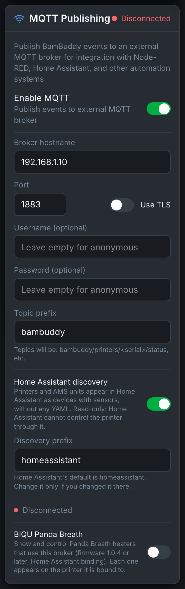

# Home Assistant Discovery

With **Home Assistant discovery** on, the [MQTT relay](mqtt.md) tells Home Assistant how to read what it publishes. Each printer shows up in Home Assistant as a device with its sensors, and each AMS unit as a device of its own, connected through its printer. No YAML is needed.

It is read-only: Home Assistant can show the printer's state and react to its events, but cannot control the printer through it.

## How It Works

The relay already publishes a retained status for every printer on `bambuddy/printers/{serial}/status`. With discovery on, it also publishes one retained [device discovery](https://www.home-assistant.io/integrations/mqtt/#device-discovery-payload) message per printer and one per AMS unit, under the discovery prefix:

```text
homeassistant/device/bambuddy_{serial}/config
homeassistant/device/bambuddy_{serial}_ams_{id}/config
```

Home Assistant's MQTT integration reads these and creates the devices. Their entities read the existing status topic, and the event entities and device triggers read the existing event topics. Nothing else is published, and the relay's topics don't change.

## Requirements

- The [MQTT relay](mqtt.md) is set up and connected.
- Home Assistant's [MQTT integration](https://www.home-assistant.io/integrations/mqtt/) is connected to the **same broker**.
- MQTT discovery is on in Home Assistant. It is on by default; it is a setting of the MQTT integration (**Settings → Devices & services → MQTT → Configure**).

## Turning It On

1. Go to **Settings → Network → MQTT Publishing**.
2. Make sure MQTT publishing is enabled and connected.
3. Turn on **Home Assistant discovery**.
4. Leave **Discovery prefix** at `homeassistant` unless you changed it in Home Assistant (see [Discovery Prefix](#discovery-prefix)).

{ .screenshot }

| Setting | Description | Default |
|---------|-------------|---------|
| **Home Assistant discovery** | Publish device discovery messages for every printer and AMS unit | Off |
| **Discovery prefix** | The topic prefix Home Assistant listens on for discovery. Shown once the switch is on | `homeassistant` |

A printer is announced once it has connected and sent its first status, so that its AMS units are known. Its devices then appear under **Settings → Devices & services → MQTT** in Home Assistant.

## What Appears in Home Assistant

### Printer Device

Each printer is a device named as in Bambuddy, with manufacturer **Bambu Lab**, its model, serial number and firmware version. If an **External URL** is set under **Settings → Network**, the device links to it (**Visit**).

| Entity | Type | Description |
|--------|------|-------------|
| *(printer name)* | Sensor | The printer's state: `idle`, `printing`, `paused`, `finished`, `failed`, `preparing` or `slicing` |
| Stage | Sensor | What the printer is doing within that state, as the printer card names it (`stg_cur_name`) |
| Progress | Sensor | Print progress in % |
| Remaining time | Sensor | Minutes left |
| End time | Sensor | When the print will end, to the minute; only while printing |
| Layer | Sensor | Current layer |
| Total layers | Sensor | Layers in the print |
| Job | Sensor | The print's name, or its file name |
| Nozzle temperature | Sensor | °C |
| Nozzle target temperature | Sensor | °C |
| Bed temperature | Sensor | °C |
| Bed target temperature | Sensor | °C |
| Part cooling fan | Sensor | Fan speed in % |
| Auxiliary fan | Sensor | Fan speed in %. Disabled by default |
| Chamber fan | Sensor | Fan speed in %. Disabled by default |
| Heatbreak fan | Sensor | Fan speed in %. Disabled by default |
| Speed level | Sensor | `silent`, `standard`, `sport` or `ludicrous` |
| Wi-Fi signal | Sensor (diagnostic) | dBm |
| HMS errors | Sensor (diagnostic) | Number of active printer errors; the errors themselves are in its `errors` attribute |
| Online | Binary sensor (diagnostic) | The printer is connected to Bambuddy |
| Problem | Binary sensor | On while there are active printer errors |
| Chamber light | Binary sensor | The chamber light is on |
| Plate needs clearing | Binary sensor | The [plate-clear gate](print-queue.md) is up: the plate must be confirmed clear before the next queued job |

Some entities only exist on printers that have the hardware:

| Entity | Only on |
|--------|---------|
| Chamber temperature, Chamber target temperature | Models with a chamber temperature sensor: X1, X1C, X1E, X2D, P2S, H2C, H2D, H2D Pro, H2S, H3C |
| Door | Models with a door sensor: X1, X1C, X1E, X2D, P2S and the H2 series |
| Nozzle 2 temperature, Nozzle 2 target temperature | Dual-nozzle printers |
| External spool (External spool 1 and 2 with two) | One per external spool the printer reports. State and attributes as for an [AMS slot](#ams-device) |

The fans that are disabled by default can be enabled on the entity in Home Assistant (**Settings → Entities**, open the entity, **Enabled**).

### AMS Device

Each AMS unit is a device of its own, connected through its printer, so it shows under the printer in Home Assistant. It is named after the printer and the unit's number as the printer counts it, for example `X1C-1 AMS 1`, `H2D AMS HT 1` or `H3C AMS 3H`, so two printers' "AMS 1" don't share a name. Its model is **AMS**, **AMS Lite**, **AMS 2 Pro**, **AMS HT** or **AMS 3H**, with the unit's serial number and firmware when the printer reports them.

| Entity | Description |
|--------|-------------|
| Humidity | %. Not on the AMS Lite, which has no humidity sensor |
| Temperature | °C. Not on the AMS Lite |
| Drying time remaining | Minutes left of a drying run. Only on the AMS 2 Pro and AMS HT |
| Slot 1 … Slot 4 | One per slot (one on an AMS HT). State: the filament type, such as `PLA`, or `empty`. Attributes: `color` (hex, such as `#FF0000`), `remaining` (%), `brand` and `name` |

### Events and Device Triggers

The printer device has three event entities, which read the existing event topics:

| Event entity | Topic | Event types | Attributes |
|--------------|-------|-------------|------------|
| Print | `printers/{serial}/print/started`, `…/completed`, `…/failed` | `started`, `completed`, `failed` | `filename`, `subtask_name`, `status` |
| Printer error | `printers/{serial}/error` | `error` | `errors` |
| Filament low | `printers/{serial}/filament/low` | `low` | `slot`, `remaining_percent`, `color` |

The same topics are also device triggers, so in the automation editor you can pick the printer under **Device** and choose one of these triggers:

| Trigger | Fires on |
|---------|----------|
| `print_started` | `printers/{serial}/print/started` |
| `print_completed` | `printers/{serial}/print/completed` |
| `print_failed` | `printers/{serial}/print/failed` |
| `error` | `printers/{serial}/error` |
| `filament_low` | `printers/{serial}/filament/low` |

The payloads of these topics are described on the [MQTT Publishing](mqtt.md#published-topics) page.

## Availability

An entity is available only while both hold: Bambuddy is running and connected to the broker (its `bambuddy/status` says `online`; the broker's Last Will says `offline` when it drops), and the printer is connected to Bambuddy.

- **Printer offline**: every entity of the printer and its AMS units is unavailable, except **Online**, which shows the printer as disconnected.
- **Bambuddy offline**: every entity is unavailable, **Online** included.

## Changes and Removal

The devices follow Bambuddy without anything to do in Home Assistant:

- **Rename a printer**: the device and its AMS devices take the new name. Entity IDs Home Assistant already created stay as they are.
- **Firmware update**: the device shows the new version.
- **AMS added or removed**: a new unit appears as a device; a unit that is gone is removed.
- **Printer deleted**: the printer and its AMS units are removed from Home Assistant.
- **Switch turned off, or MQTT publishing turned off**: all Bambuddy devices are removed.
- **Topic prefix or discovery prefix changed**: the devices are removed and announced again with the new prefixes.

If the broker is unreachable when one of these happens, Bambuddy removes the devices once it can reach the broker again, also after a restart in between.

When Home Assistant restarts it sends its birth message (`online` on `homeassistant/status`, under the discovery prefix), and Bambuddy sends every device again. It does the same when its own connection to the broker comes back. The messages are retained, so Home Assistant also finds them on the broker when it connects.

## Discovery Prefix

Home Assistant listens for discovery messages under `homeassistant` unless that was changed in its MQTT integration. Set **Discovery prefix** to the same value.

With discovery on, the **Topic prefix** of the relay must differ from the discovery prefix: the relay's status topics would otherwise sit among Home Assistant's discovery topics. Bambuddy doesn't save the two set to the same value while discovery is on (the settings show *The discovery prefix must differ from the topic prefix.*), and a restored backup with both the same keeps discovery off. With discovery off, any topic prefix can be used. Leading and trailing slashes don't count, so `homeassistant/` is the same as `homeassistant`.

The discovery prefix can't contain `+` or `#`, which are MQTT wildcards.

Run only one Bambuddy per topic prefix on a broker. Two installs with the same topic prefix share their status topics, and each would remove the other's devices from Home Assistant.

## Controlling the Printer

Discovery only reads what the relay publishes. To control a printer from Home Assistant (pause, stop, light, speed) or to get its camera, use the [ha-bambulab](https://github.com/greghesp/ha-bambulab) integration, which talks to the printer directly. The two can be used side by side.

## Troubleshooting

| Issue | Solution |
|-------|----------|
| No device appears | Check that the relay shows **Connected**, that Home Assistant's MQTT integration uses the same broker, and that discovery is on there. Check that **Discovery prefix** matches Home Assistant's. A printer is only announced once it is connected and has reported to Bambuddy |
| `mosquitto_sub -t "homeassistant/device/#" -v` shows nothing | **Home Assistant discovery** is off, or the topic prefix and discovery prefix are the same, which keeps it off |
| Auxiliary, Chamber or Heatbreak fan is missing | They are disabled by default; enable them on the entity in Home Assistant |
| A device stays after Bambuddy was removed or reset | Bambuddy clears its devices when the switch is turned off. If it never got the chance, delete the device in Home Assistant (**Settings → Devices & services → MQTT**, open the device, **Delete**), or clear its retained config on the broker |
| All entities unavailable | Bambuddy is offline, or the printer is: see [Availability](#availability) |
