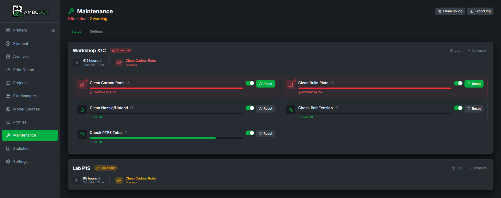
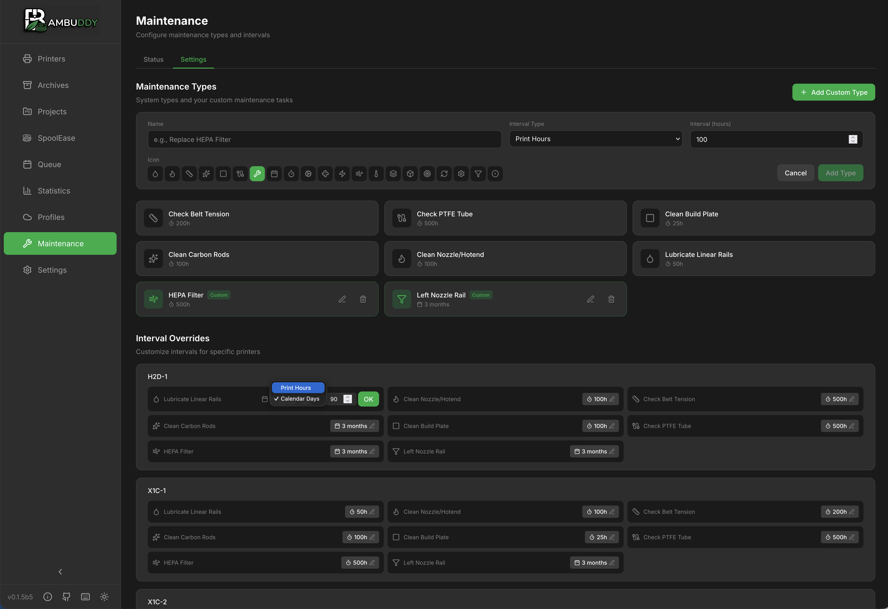
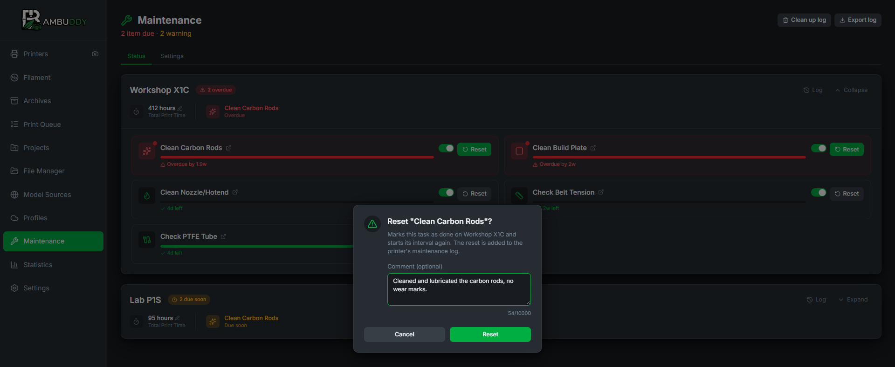
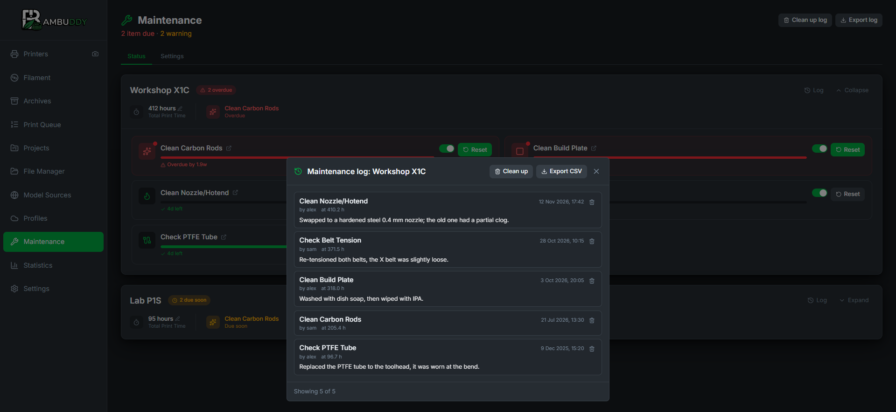
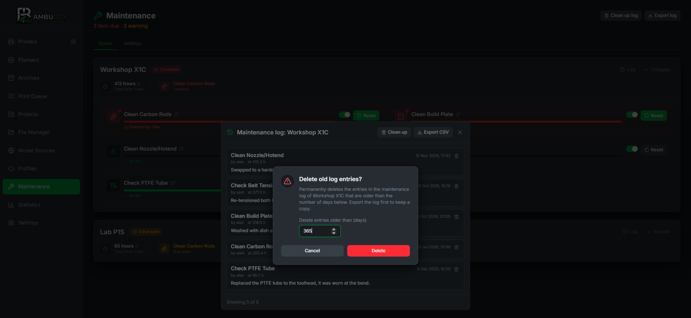

# Maintenance Tracker

Schedule and track maintenance tasks to keep your printers running reliably.

{ .screenshot }

!!! tip "Looking for the per-printer on/off switch?"
    The **Maintenance Tracker** on this page is for **interval-based scheduled tasks** (clean nozzle every 100 hours, check belts every 200 hours, etc.). If you want to take a single printer **out of service right now** — stop MQTT, drop it from the queue, hide it from notifications — that's **[Maintenance Mode](printer-control.md#maintenance-mode)** on the Printer Control page. The two pair well: when you start a real task from the tracker, you can flip the same printer to Maintenance Mode while the cover is open.

---

## :material-tools: Overview

The maintenance tracker helps you:

- **Schedule** recurring maintenance tasks
- **Track** when maintenance was last performed
- **Get notified** when maintenance is due
- **Log** every reset with a comment, who did it and when, and export the log as CSV

---

## :material-format-list-checks: Maintenance Types

### Default Types

Bambuddy includes common maintenance tasks:

| Type | Default Interval | Applies To |
|------|-----------------|------------|
| **Clean Build Plate** | Every 25 hours | All printers |
| **Clean Nozzle/Hotend** | Every 100 hours | All printers |
| **Check Belt Tension** | Every 200 hours | All printers |
| **Check PTFE Tube** | Every 500 hours | All printers |
| **Lubricate Carbon Rods** | Every 50 hours | X1/P1 |
| **Clean Carbon Rods** | Every 100 hours | X1/P1 |
| **Lubricate Steel Rods** | Every 50 hours | P2S |
| **Clean Steel Rods** | Every 100 hours | P2S |
| **Lubricate Linear Rails** | Every 50 hours | A1/H2D |
| **Clean Linear Rails** | Every 100 hours | A1/H2D |

#### Bambu Lab H3C

The H3C gets its own schedule, taken from Bambu Lab's [H3C maintenance guides](https://wiki.bambulab.com/en/h3c/maintenance/periodic-maintenance). Each task links to the matching guide. In place of the generic **Lubricate Linear Rails**, **Clean Linear Rails**, **Clean Nozzle/Hotend** and **Check PTFE Tube** tasks, an H3C shows:

| Type | Default Interval |
|------|-----------------|
| **Lubricate X/Y Rails (H3C)** | Every 30 days |
| **Grease Z Screws (H3C)** | Every 90 days |
| **Oil XY Idler Pulleys (H3C)** | Every 90 days |
| **Grease Toolhead (H3C)** | Every 90 days |
| **Oil SwapTek Rack (H3C)** | Every 30 days |
| **Clean Hotends (H3C)** | Every 100 hours |
| **Clean Extruder Wheel (H3C)** | Every 7 days |
| **Clean Cameras (H3C)** | Every 90 days |
| **Clean Fans (H3C)** | Every 90 days |
| **Replace Air Filter (H3C)** | Every 1440 hours |
| **Check Filament Tubes (H3C)** | Every 500 hours |
| **AMS 3H: Check Desiccant** | Every 30 days |
| **AMS 3H: Inlets & Gears** | Every 90 days |
| **AMS 3H: Clean Dryer Fans** | Every 180 days |

**Check Belt Tension** links to the H3C's own belt guide. The day-based tasks count from when the printer was added to Bambuddy; press **Reset** after doing one to start its timer from that day.

These H3C task types are only listed while an H3C is in Bambuddy, so an install without one sees the same maintenance types as before.

### Hiding Default Types

If a default maintenance type isn't relevant to your setup, you can remove it:

1. Go to **Settings** > **Maintenance**
2. Click the :material-delete: icon next to the default type
3. Confirm deletion

Hidden default types can be restored at any time — click **Restore Default Tasks** to bring them all back.

### Custom Types

Create your own maintenance tasks:

1. Go to **Settings** > **Maintenance**
2. Click **Add Maintenance Type**
3. Enter name and description
4. Set default interval
5. Click **Save**

Maintenance types are shared by all printers. Deleting a custom type removes it from every printer, including printers of other teams when [printer access](authentication.md#printer-access) is limited. Its resets stay in the [maintenance log](#maintenance-log), under the task's name.

{ .screenshot }

---

## :material-calendar-clock: Interval Types

### Print Hours

Schedule based on actual print time:

- Example: Lubricate every 100 hours
- Accumulated from print durations

### Calendar Days

Schedule based on calendar time:

- Example: Check belts every 30 days
- Counts calendar days regardless of usage

---

## :material-plus-circle: Setting Up Maintenance

### Per-Printer Configuration

Each printer has its own maintenance schedule:

1. Go to **Maintenance** page
2. Select your printer
3. Click **Configure**
4. Enable/disable maintenance types
5. Adjust intervals as needed
6. Click **Save**

### Interval Customization

Override default intervals per printer:

| Printer | Clean Build Plate |
|---------|:-----------------:|
| Workshop X1C | Every 25 hours |
| Office P1S | Every 15 hours |
| Garage A1 | Every 50 hours |

---

## :material-check-circle: Logging Maintenance

### Resetting a Task

When you have done a maintenance task:

1. Go to the **Maintenance** page
2. Expand the printer and find the task
3. Click **Reset**
4. Optionally add a comment: what you did, parts you replaced, anything you noticed (up to 10,000 characters)
5. Click **Reset** in the dialog

The task's interval starts again, and the reset is added to the printer's [maintenance log](#maintenance-log).

{ .screenshot }

!!! tip "Typed a comment?"
    While the comment box has text, clicking outside the dialog or pressing ++esc++ doesn't close it, so a stray click can't throw your comment away. Use **Cancel** to close it.

---

## :material-alert: Due Status

### Status Indicators

| Status | Meaning |
|:------:|---------|
| :material-check-circle:{ style="color: #4caf50" } OK | Not due yet |
| :material-alert:{ style="color: #ff9800" } Due Soon | Approaching due |
| :material-alert-circle:{ style="color: #f44336" } Overdue | Past due |

### Due Soon Threshold

Configure when "Due Soon" triggers:

- Default: 80% of interval
- Example: Clean Build Plate every 25 hours → "Due Soon" at 20 hours

---

## :material-bell-ring: Notifications

Get notified when maintenance is due:

1. Go to **Settings** > **Notifications**
2. Enable **Maintenance Due** event
3. Configure your notification provider

### Notification Timing

- **Due Soon**: When threshold reached
- **Overdue**: When interval exceeded

[:material-arrow-right: Notification setup](notifications.md)

---

## :material-history: Maintenance Log

Every reset is logged with:

| Field | Description |
|-------|-------------|
| **Task** | The maintenance task that was reset |
| **Printer** | The printer it was done on |
| **By** | Who reset it (when [authentication](authentication.md) is on) |
| **When** | Date and time of the reset |
| **Print hours** | The printer's print hours at that moment |
| **Comment** | The optional comment from the reset dialog |

### Viewing a Printer's Log

Click **Log** on a printer on the **Maintenance** page. It lists the printer's resets, newest first, 50 at a time; **Load more** shows older ones.

{ .screenshot }

### Exporting the Log

- **Export CSV** in a printer's log downloads that printer's log
- **Export log** at the top of the **Maintenance** page downloads the log of every printer you can see as one CSV, including printers that were deleted (if you can see every printer)

The CSV has the columns *Performed at (UTC)*, *Printer*, *Task*, *Performed by*, *Print hours* and *Comment*. It opens in Excel and LibreOffice with accents and umlauts intact, and comments that start like a spreadsheet formula (`=`, `+`, `-`, `@`) are exported as text, so they can't run as formulas.

### Deleted Printers, Tasks and Users

Log entries keep the printer, task and user names they had at the time of the reset. Deleting a printer, a custom task or a user doesn't delete their entries: the log stays a record of what was done. A deleted printer's entries are in the **Export log** CSV.

### Cleaning Up the Log

Entries are kept until you delete them. To delete old entries:

1. Click **Clean up** in a printer's log, or **Clean up log** at the top of the **Maintenance** page for every printer you can see
2. Enter how old entries must be to be deleted, in days (at least 1; 365 by default)
3. Click **Delete**

To delete a single entry, for example a reset made by mistake, click the :material-delete: icon next to it in the log. The task stays reset; only the log entry is removed.

{ .screenshot }

!!! warning "Deleting can't be undone"
    A deleted entry is removed with its comment, including from the task's reset history. Export the log first if you want to keep a copy.

### Permissions

When [authentication](authentication.md) is on:

| Action | Permission |
|--------|------------|
| View and export the log | `maintenance:read` |
| Reset a task (and add a comment) | `maintenance:update` |
| Clean up the log, delete an entry | `maintenance:delete` |

A user whose [printer access](authentication.md#printer-access) is limited sees, exports and cleans up only the log of their printers, and not the entries of deleted printers.

### Upgrading

Resets made before the maintenance log existed are copied into it once, when you upgrade. They have no user, since none was recorded then.

---

## :material-printer: Per-Printer View

### Dashboard

Each printer shows maintenance status:

```
Workshop X1C
─────────────────────────────
✅ Clean Build Plate     12 hours until due
⚠️ Lubricate Carbon Rods  8 hours until due
❌ Check Belt Tension    OVERDUE
✅ Clean Nozzle/Hotend   65 hours until due
```

### Quick Actions

- **Expand**: See all of the printer's maintenance tasks
- **Reset**: Log completed maintenance, with an optional comment
- **Log**: See and export past maintenance

---

## :material-lightbulb: Maintenance Tips

!!! tip "Bed Cleaning"
    Clean with IPA between prints for best adhesion. Deep clean with dish soap weekly.

!!! tip "Lubrication"
    Use appropriate grease for linear rails. Don't over-lubricate.

!!! tip "Belt Tension"
    Belts should be firm but not overly tight. Use the "guitar string" test.

!!! tip "Nozzle Inspection"
    Check for wear, especially with abrasive filaments. Replace when worn.

!!! tip "Filters"
    HEPA and carbon filters lose effectiveness over time. Replace as recommended.

!!! tip "Document Everything"
    Add notes when logging maintenance to build a history of what works.

---

## :material-cog: Best Practices

### Regular Schedule

- Check maintenance status weekly
- Don't skip overdue items
- Build maintenance into your routine

### Preventive vs Reactive

- Preventive: Follow intervals
- Reactive: Fix when broken
- **Preventive is better!**

### Track Everything

- Log all maintenance
- Note any issues found
- Track parts replaced
