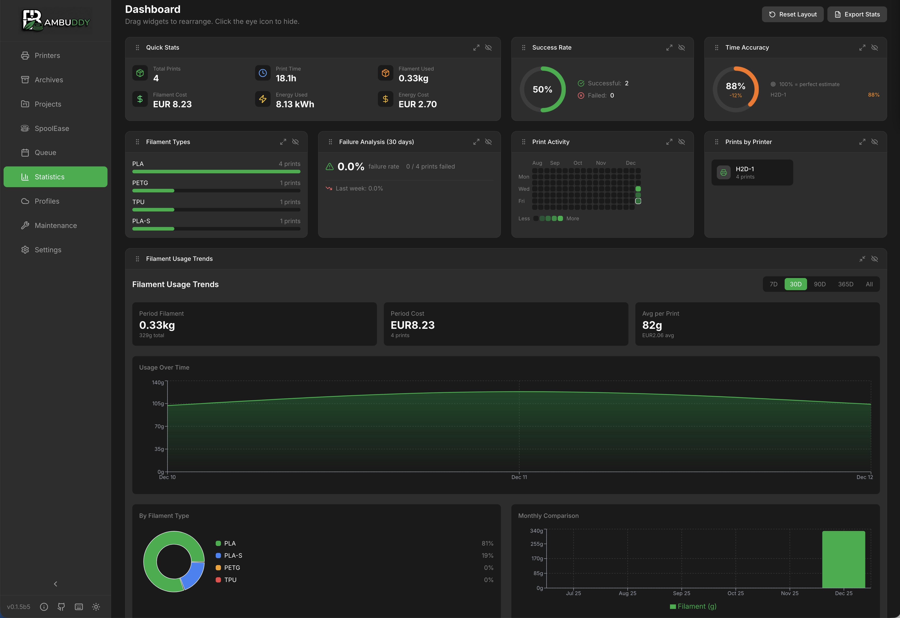

# Statistics Dashboard

The Statistics page provides analytics and insights through customizable, drag-and-drop widgets.

{ .screenshot }

---

## :material-view-dashboard: Dashboard Overview

The dashboard displays multiple widgets that you can:

- **Drag** to reorder
- **Resize** to emphasize important data
- **Hide** widgets you don't need
- **Reset** to default layout

---

## :material-chart-pie: Available Widgets

### Print Success Rate

Track reliability across all printers:

| Status | Description |
|:------:|-------------|
| :material-check-circle:{ style="color: #4caf50" } Success | Completed prints |
| :material-close-circle:{ style="color: #f44336" } Failed | Prints that failed |
| :material-stop-circle:{ style="color: #ff9800" } Stopped | Manually cancelled |

- Visual pie chart breakdown
- Per-printer filtering
- Success rate percentage

### Filament Usage

Monitor material consumption:

- **By type** - PLA, PETG, ABS, etc.
- **By color** - Color breakdown
- **Over time** - Trend charts
- **Total weight** - Cumulative kg/g
- **Energy Over Time** - When prints in the selected range carry measured smart-plug energy, an additional chart plots kWh per day (per hour for ranges of a week or less), with the range's total kWh and energy cost in the header. Setups without a [smart plug](smart-plugs.md) don't see this chart.

!!! info "Records include energy and wear cost"
    The **Most Expensive** record ranks prints by filament cost **plus** measured per-print energy cost **plus** [printer wear](#printer-wear-cost). A cost that wasn't recorded for a print simply doesn't add.

### Print Activity Calendar

GitHub-style contribution calendar:

- Daily print activity heatmap
- Color intensity = number of prints
- Click any day to see prints
- Identify printing patterns

### Quick Stats

Summary statistics at a glance:

- **Total prints** in selected period
- **Total filament** used (grams)
- **Filament cost**
- **Total print time**
- **Energy used / cost** — honours the tracking mode set in Settings → General → Energy (Per-Print or Total Consumption) and respects the selected date range.
- **Wear cost** — printer wear across the period (see [Printer Wear Cost](#printer-wear-cost)). Only shown once a printer has a wear cost set.

!!! note "Configuration Required"
    Requires filament costs in Settings to calculate cost data.

!!! info "Statistics aggregate per print event, not per archived file"
    Quick Stats and Statistics queries sum over individual print events (the same data backing the [Per-archive Print Log](archiving.md#per-archive-print-log)), not over archive rows. So every reprint contributes its own filament / time / cost / count to the totals — even if you've printed the same archived 3MF ten times. A failed reprint at 10 g of a previously-successful 100 g print is recorded as two distinct events; Quick Stats correctly add up to 110 g across both, instead of the failed run overwriting the source archive's data.

!!! info "Deleting an archive keeps its Quick Stats contribution"
    By default, deleting an entry on the Archives page **does not** rewind its filament, time, cost, or energy contribution from Quick Stats — the file is removed from disk and the row disappears from listings, but the totals stay honest. To also drop the print from statistics, tick the **Also remove this print from Quick Stats** checkbox in the delete confirmation dialog. See [Delete Behavior](archiving.md#delete-behavior) on the Archiving page for details. The opt-in hard-delete removes the archive's linked Print Log entries as well so its run-by-run contributions disappear from the totals together.

!!! tip "Energy warming-up indicator"
    In **Total Consumption** mode, date-range energy values are computed from hourly snapshots of each smart plug's lifetime counter. On a fresh install or shortly after an upgrade, the first snapshot before your selected range may not exist yet — the Energy Used / Energy Cost tiles show a small yellow warning icon with a tooltip explaining the situation. After ~1 hour of runtime the indicator disappears for any range that starts after the first snapshot. See [Energy Tracking](energy.md#total-mode) for details.

### Time Accuracy

Analyze estimated vs actual print times:

- **Average accuracy** - How close estimates are
- **Per-printer** - Compare printer accuracy
- **Trend** - Is accuracy improving?

### Print Duration Distribution

Understand typical print lengths:

- Bar chart with duration buckets (<30m, 30m-1h, 1-2h, 2-4h, 4-8h, 8-12h, 12-24h, 24h+)
- Quickly see your most common print duration range

### Filament by Type

Pie chart of material distribution:

- Click segments to filter
- Legend with exact amounts
- Percentage breakdown

### By Supplier

Consumption and cost grouped by where the spools were bought:

- One row per supplier marked **Bought here** on at least one spool (see [Suppliers](inventory.md#suppliers))
- **Spools** and **Remaining** stock — always the current state; an over-used spool counts as empty
- **Consumed** and **Cost** — from the recorded usage history, following the selected date range; archived spools included
- Sorted by consumption, heaviest first
- Hidden in Spoolman mode — it groups Bambuddy's own spools, not the assignments kept for Spoolman spools

### By Material Number

Stock, consumption and cost grouped by your internal material number (see [Material Numbers](inventory.md#material-numbers)):

- One row per material number in use; spools without a number are left out
- **Spools** and **Remaining** stock — always the current state; an over-used spool counts as empty and never reduces its siblings' stock
- **Consumed** and **Cost** — from the recorded usage history, following the selected date range; archived spools included. A number with stock but no usage in the range still lists, with zero consumption
- Sorted by consumption, heaviest first; ties by number, so the order is stable
- Hidden in Spoolman mode — it groups Bambuddy's own spools

### Printer Utilization

Hours of active printing:

- Idle time percentage
- Per-printer breakdown
- Most/least used printers

### Recent Activity

Latest completed prints:

- Quick status overview
- Click to view archive
- Last 10 prints

---

## :material-gesture-tap-drag: Customizing Layout

### Drag and Drop

Rearrange widgets:

1. Hover over widget header
2. Click the grip icon :material-drag:
3. Drag to new position
4. Release to drop

### Resizing

Change widget sizes:

1. Click the resize icon on widget
2. Cycles through: Small → Medium → Large → Full Width
3. Layout adjusts automatically

### Hiding Widgets

Remove widgets from view:

1. Click the **eye** icon :material-eye-off: on widget
2. Widget is hidden
3. Re-enable from controls

### Controls Location

Dashboard controls are in the header row:

- **Hidden** - Show/manage hidden widgets
- **Reset Layout** - Return to default

### Persistence

Your layout preferences are:

- Saved automatically
- Persist across sessions
- Stored per-user

---

## :material-filter: Filtering Data

### Time Range

| Range | Description |
|-------|-------------|
| Today | Since midnight |
| This week | Since Monday |
| This month | Since the 1st |
| Last 7 days | Past week |
| Last 30 days | Past month |
| Last 90 days | Past quarter |
| This year | Since 1 January |
| All time | Everything |
| Custom | Pick start and end dates |

Days are calendar days in your browser's time zone, not UTC: "Today" at 01:30 is today, from midnight, also when Bambuddy runs in another zone.

### Per-User Filtering

Filter all statistics by a specific user — useful for universities, makerspaces, and multi-user environments where you need per-person accountability or cost tracking.

**Requirements:**

- Authentication must be enabled
- User must have the `stats:filter_by_user` permission (Administrators only by default)

**How to use:**

1. Click the **user dropdown** in the stats header (next to the timeframe selector)
2. Select a user to see only their prints, filament usage, and costs
3. Select **"All Users"** to return to global statistics
4. Select **"No User (System)"** to see prints without user attribution (e.g. slicer-initiated or pre-auth prints)

The filter applies to all widgets, failure analysis, and CSV/Excel exports.

!!! info "Custom Permission Groups"
    To grant this permission to non-admin users, create a custom group in **Settings → Users** and add the `stats:filter_by_user` permission.

### Printer Selection

View statistics for:

- **All printers** combined
- **Individual printer** only
- **Compare** across printers

---

## :material-cash: Cost Configuration

To enable cost tracking:

1. Go to **Settings** > **Filaments**
2. Add your filaments:
   - Material type
   - Color
   - **Cost per kg**
   - Vendor (optional)
3. Statistics calculate costs automatically

### Cost Calculation

```
Print Cost = (Filament Used in grams / 1000) × Cost per kg
```

Prints on a printer with an assigned [smart plug](smart-plugs.md) additionally record their measured **energy cost** (see [Energy Tracking](energy.md#cost-calculation)). Energy feeds the Energy Used / Energy Cost tiles, the Energy Over Time chart, and the Most Expensive record — filament and energy costs are otherwise reported separately.

### Printer Wear Cost

A printer wears out as it prints: nozzles, belts, the hotend and eventually the machine itself. To include that in your print costs, give each printer a **wear cost per printing hour**:

1. On the **Printers** page, open the printer's menu and choose **Edit**
2. Enter **Wear cost per printing hour**, for example `0.20` for a 600 printer you expect to last 3,000 hours
3. Save

```
Wear Cost = Print duration in hours × Wear cost per printing hour
```

- The duration is the run's duration as shown in the [Print Log](print-log.md), including failed and cancelled runs, which still wore the printer. A run closed after Bambuddy was offline has no known duration and gets no wear cost.
- The rate applies from the next print on. Earlier prints keep the cost they had, and **Recalculate Costs** doesn't change wear.
- Leave the field empty (or 0) to turn wear cost off for that printer.
- Like energy, the archive card shows the first print's wear; every reprint has its own figure in the Print Log.
- Wear appears on the archive card (:material-wrench: icon), as a hidden **Wear Cost** column in the Print Log, as a Quick Stats tile, in project totals and in the measured cost of a [batch order](print-queue.md).
- Charges in [Billing](billing.md) stay filament only. Wear is part of what a print costs you, not something Bambuddy bills.

### Recalculate Costs

If you change a spool's price or your default filament cost, existing archives retain their original calculated costs. To update all archives with current pricing:

1. Click **Recalculate Costs** in the dashboard header
2. Each spool usage record gets its spool's current price: the spool's own price in the inventory or in [Spoolman](spoolman.md), or the default filament cost for a built-in spool without one. A record of a spool that was deleted keeps what it cost. If Spoolman can't be reached, its spools' records keep their price and a message says how many.
3. Each archive's cost is recalculated from them, as the cost of **one print** of it. The share of its grams that spools tracked, over all its prints, is priced at their average price per gram, and the rest at the default filament cost. Without recorded usage, the filament catalog price or the default cost applies.
4. Each print in the Print Log moves by the change of its own usage records, so the statistics follow the new prices too. The archive's latest completed print takes the archive's new cost instead when it still had the archive's cost and either has no usage records or holds all of the archive's records.

!!! info "Reprint Costs"
    The archive card shows what one print of the file costs, and a reprint does not change it. Each print, reprints included, has its own entry in the Print Log with its own cost, and the statistics add those up, so they reflect the total filament expenditure across all prints of the same file.

---

## :material-file-export: Export Data

Export statistics:

### Export Options

| Format | Best For |
|--------|----------|
| **CSV** | Spreadsheets, analysis |
| **Excel** | Reports, formatting |

### Export Contents

- Print history
- Duration, filament, cost
- Success/failure status
- Filtered by current view

[:material-arrow-right: Full export guide](export.md)

---

## :material-refresh: Data Refresh

Statistics update automatically when:

- New prints complete
- Archives are edited
- Filters change

Manual refresh via the refresh button in header.

---

## :material-lightbulb: Tips

!!! tip "Weekly Review"
    Check the dashboard weekly to spot trends and issues early.

!!! tip "Per-Printer Analysis"
    Use printer filtering to identify reliability issues with specific machines.

!!! tip "Cost Awareness"
    Configure filament costs to understand your actual printing expenses.

!!! tip "Monthly Export"
    Export data monthly for record keeping and long-term analysis.

!!! tip "Time Accuracy"
    Watch time accuracy to calibrate your expectations for print times.

!!! tip "Calendar Patterns"
    The activity calendar reveals your printing habits - useful for planning.
