# Daily use

Orders is organised by what happens to an order next. Every order has a ship-by day and turns red when it is late. Clicking an order on any page opens its details: what was paid and where it ships, its items, its prints in Bambuddy and its history.

---

## The pages

### Overview

What needs you, what is printing, what is ready to pack.

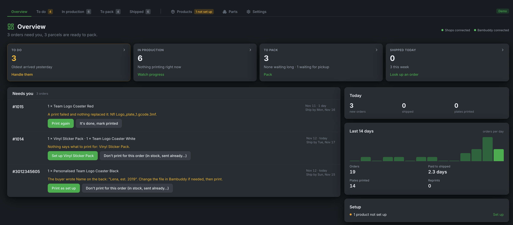{ .screenshot }

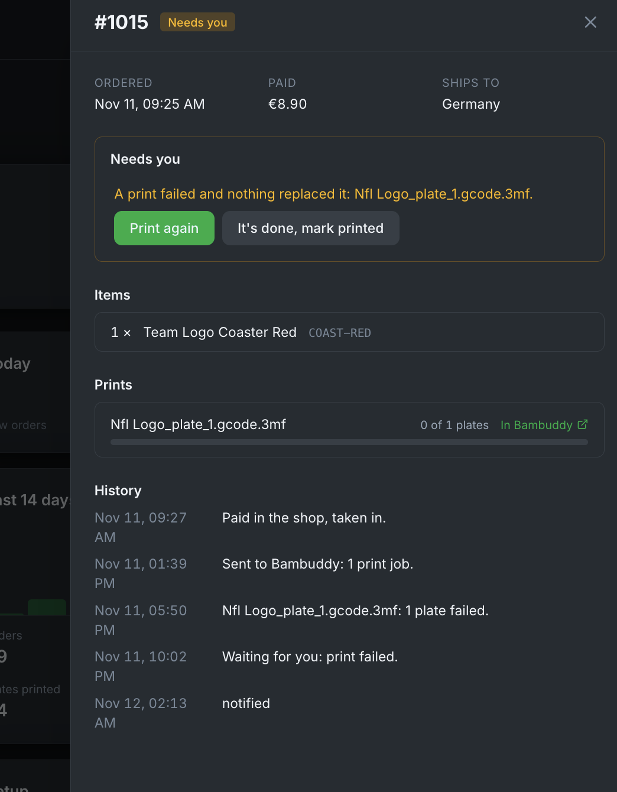{ .screenshot }

### To do

Orders that need a decision: not set up, personalised, print failed, a Bambuddy error. Each has its fix right there. Finished top-ups wait here under **Stock to count**.

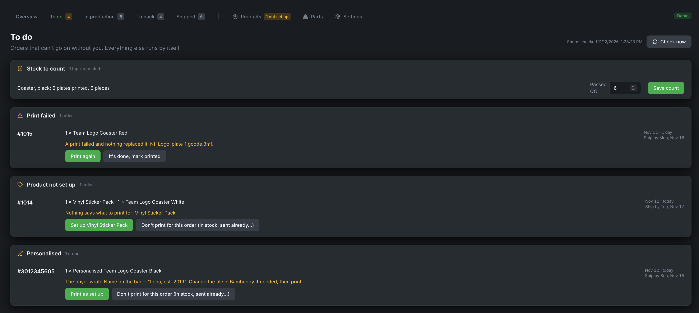{ .screenshot }

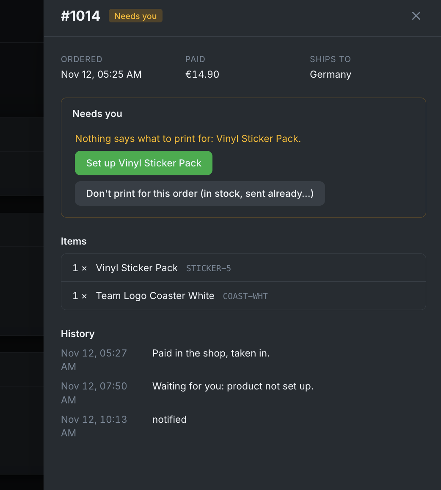{ .screenshot }

### In production

Live print progress from Bambuddy.

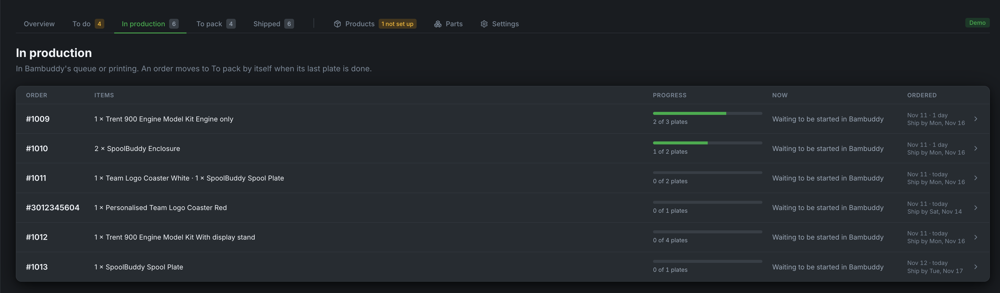{ .screenshot }

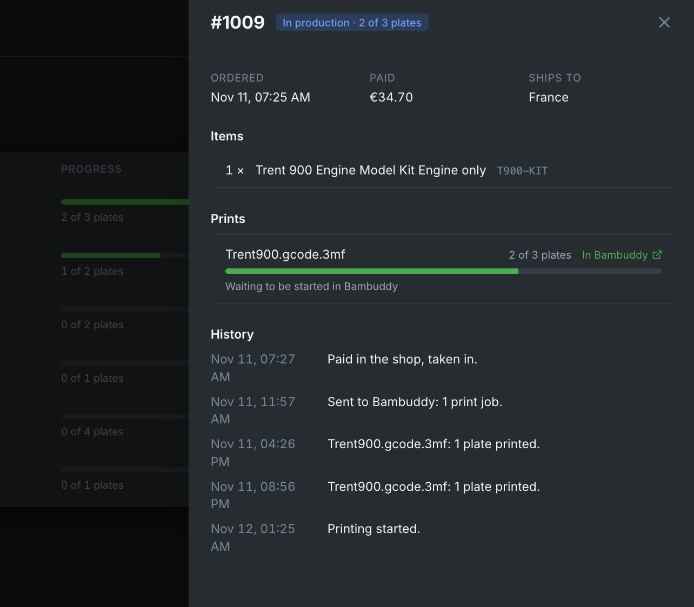{ .screenshot }

### To pack

Printed orders with a pick list and a printable pack list. Tick them, press **Ship**, choose the carrier and enter the tracking numbers. The shop marks them fulfilled; Shopify emails the buyer if you leave **notify** on, Etsy always does.

**Local pickup** orders (Shopify) are marked "Pickup", and "Pay at pickup" while unpaid, and have no Ship button. **Ready for pickup** tells Shopify, which emails the buyer; the order then waits under "Waiting for pickup" until you press **Picked up**. A buyer who is already there can be handed the order with **Picked up** straight away.

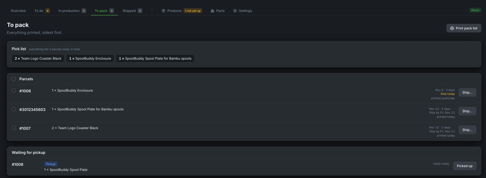{ .screenshot }

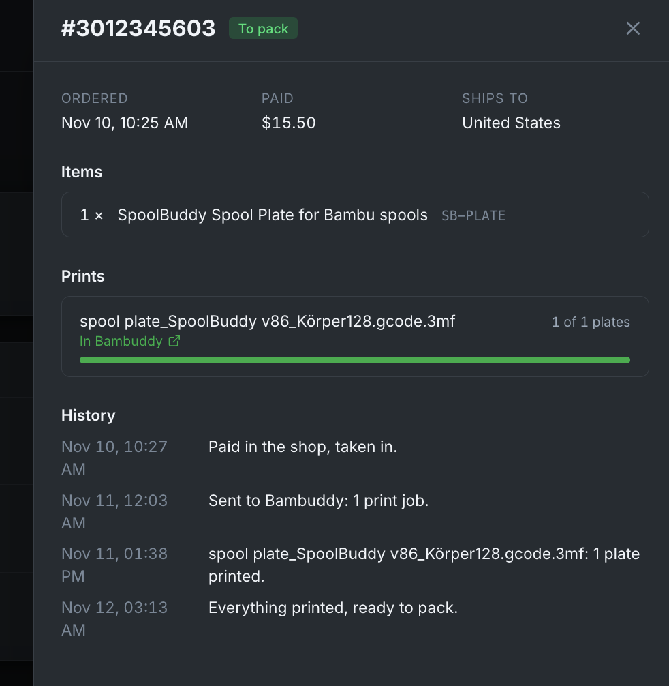{ .screenshot }

### Shipped

Shipped and cancelled orders with tracking links, for the last 30 days, 90 days, year or any time, searchable by order number, item, SKU or tracking number.

**Archive** puts a finished order away; **Archive old orders** does it for every order finished more than 30, 90, 180 or 365 days ago. Archived orders are never deleted: they stay under **Archived**, searchable, and **Bring back** returns one.

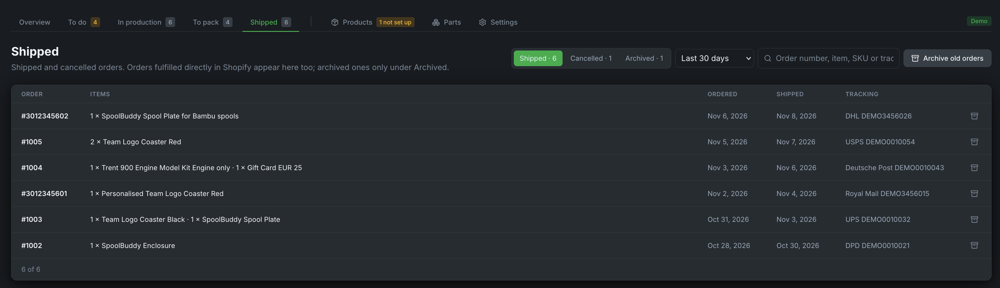{ .screenshot }

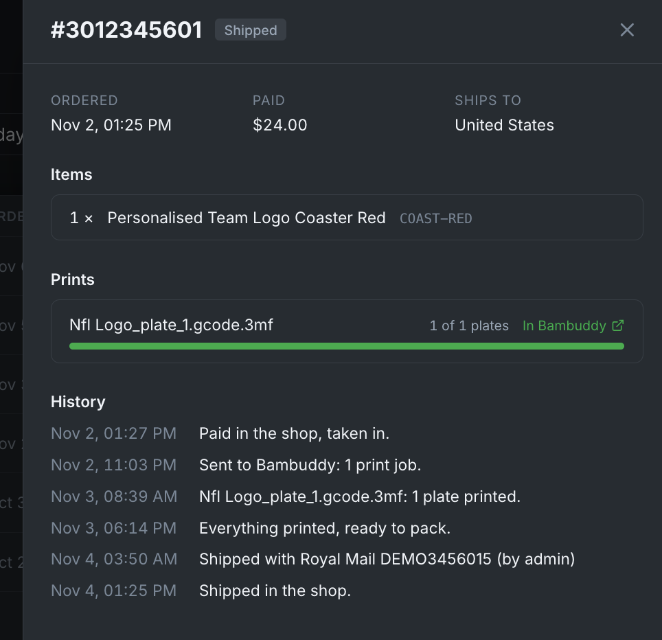{ .screenshot }

### Products and Parts

See [Products and stock](products.md).

## Settings worth knowing

- **Order processing → Send paid orders automatically**: off means every order waits in **To do** until you press **Send**. Keep it off for your first days, until you trust your setups.
- **Order processing → Start print jobs by hand in Bambuddy**: on means the jobs land in Bambuddy's queue staged and wait until someone starts them there; **In production** shows "Waiting to be started in Bambuddy". Off, the default, starts them as soon as a printer is free.
- **Order processing → Handling time**: working days until a Shopify order should ship, which sets its ship-by day. The default is 3; 0 switches it off. Etsy orders use the ship-by date Etsy gives them, from your listings' processing times.
- **Notifications**: which events reach your phone through Bambuddy's notification channels: orders that need you, a shop that can't be reached, the daily pack list, new orders. In Bambuddy, switch on **Messages from connected apps** for those channels.
- **Business details**: your logo, business name, website and contact, printed at the head of each parcel's page on the pack list. Leave a field empty to leave it off.

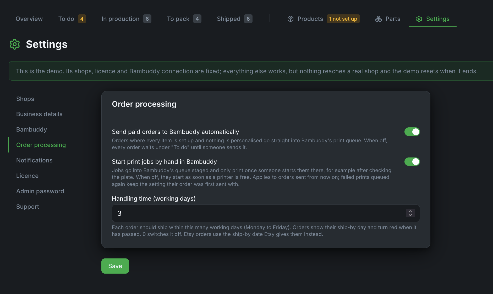{ .screenshot }

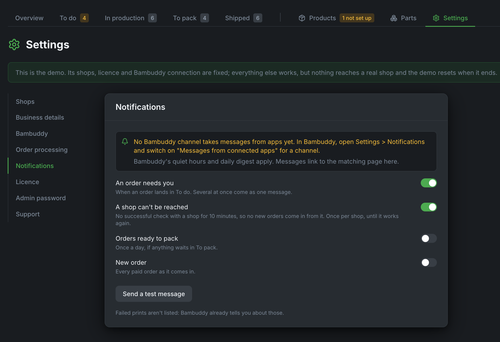{ .screenshot }

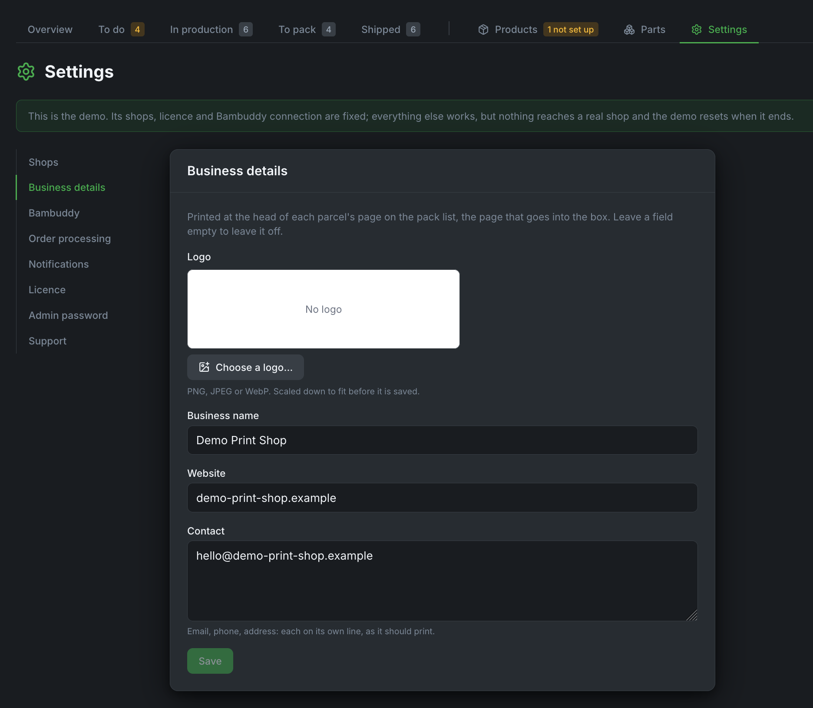{ .screenshot }

## Orders inside Bambuddy

Add Orders to Bambuddy's sidebar: in Bambuddy, **Settings → Sidebar Links → External links**, with Orders' address. Orders then opens inside Bambuddy, and the link shows how many orders and top-ups wait in **To do** (the API key needs **Send notifications**).

!!! note
    Open Bambuddy by the **same address you entered in Orders' setup**. For safety, Orders refuses to be shown inside any other site, so a different host name or IP address leaves the frame empty.
