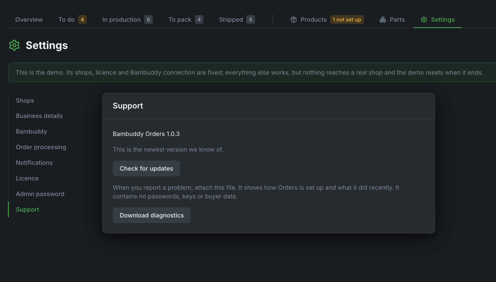
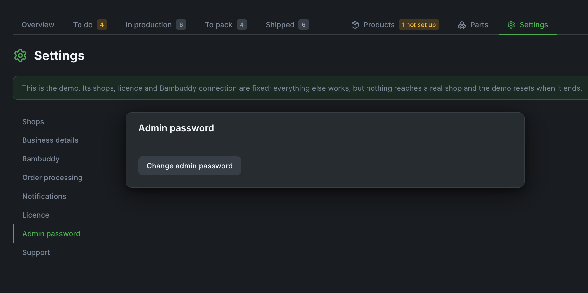

# Help and support

## Where to ask

- **Using Orders, and faults**: open an issue at [github.com/maziggy/bambuddy/issues](https://github.com/maziggy/bambuddy/issues) and say it is about **Bambuddy Orders**. Issues are public: never post your licence key, orders or buyer data there.
- **Your licence key, your subscription or a refund**: email [support@bambuddy.cool](mailto:support@bambuddy.cool), or reply to the email with your key.

What helps us help you:

1. what you did and what you expected;
2. what happened instead (a screenshot helps);
3. for a fault, **Settings → Support → Download diagnostics**. The file holds your setup and Orders' recent log, but no passwords, keys or buyer data. Have a look before you send it, and send it by email rather than posting it.

{ .screenshot }

## Known limits

- New orders arrive by polling: Shopify within about a minute, Etsy within 5 minutes.
- A whole order ships at once. Partial shipments are done in Shopify.
- An order that is partly collected and partly shipped is treated as shipped.
- An order edited in Shopify while it is printing waits in **To do**: once printing has started, Orders doesn't add or remove prints in Bambuddy by itself.
- An Etsy order refunded in part still prints every item: Orders reads an Etsy order's items once.
- In some regions Etsy only lets partner apps mark orders shipped. There the order says so; mark it shipped on Etsy, and Orders follows.
- Bambuddy's queue gets one batch per print file per order, so an order with three different items shows up there as three groups. Orders shows them together.

## Lost the admin password

While you still know it, change it under **Settings → Admin password**.

{ .screenshot }

If it is lost, set a new one on the server:

```bash
docker exec -it bambuddy-orders reset-admin-password
```
