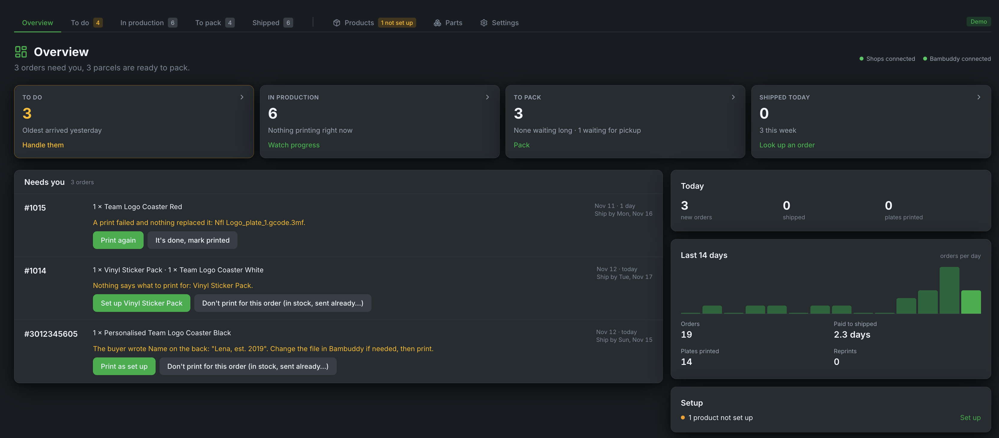

# Bambuddy Orders

Bambuddy Orders takes the paid orders from your Shopify and Etsy shops, sends what needs printing to Bambuddy's print queue, follows the prints, and reports each order back to the shop as shipped, with its tracking number. From order to parcel, one screen.

It is a separate application from Bambuddy, with a yearly licence. Bambuddy itself stays free and open source; Orders talks to it only through Bambuddy's API.

{ .screenshot }

!!! tip "Try it first"
    The [Bambuddy demo](https://demo.bambuddy.cool) includes Orders with a sample shop: open **Orders** in the demo's sidebar. Nothing there reaches a real shop, and the demo resets when it ends.

---

## How an order flows

1. A buyer pays in your shop. Within about a minute (Etsy: within 5 minutes) the order is in Orders.
2. Orders looks up the product's setup: which print file, which plate, how many units a plate holds. Items already on your shelf are taken from stock.
3. The prints go to Bambuddy's queue, as one batch per print file, and Orders shows their progress under **In production**.
4. Printed orders wait under **To pack** with a pick list. You pack them, enter the tracking numbers, and press **Ship**: the shop marks the order fulfilled and emails the buyer (in Shopify, only if you leave **notify** on).

Anything Orders can't decide alone (a product without a setup, a personalised item, a failed print) stops under **To do**, with its fix right there.

## Your data stays with you

Orders runs on your own server, next to Bambuddy. Your shop credentials stay encrypted in your installation, and Orders stores no buyer names, email or postal addresses: only the order number, the items, the total and the country it ships to.

Etsy is the one exception to "nothing leaves your server": Etsy requires our app's key on every request, so Etsy requests pass through our gateway. It passes them through without storing the orders; see [Connecting shops](shops.md#etsy).

## Plans

| | Starter | Pro |
|---|---|---|
| Connected shops (Shopify and Etsy together) | 2 | 10 |
| Features | all | all |
| Billing | yearly | yearly |

A licence runs one Orders installation. Full refund within 14 days of the purchase or of a renewal, no reason needed.

When a licence ends, Orders stops taking in **new** orders. Orders already in it can still be printed, packed and shipped, and nothing is deleted. Renewing takes in the orders placed in the meantime, as far as the shop still lists them (Shopify: the last 60 days).

## What you need

- **Bambuddy 1.3.0 or newer**, reachable from the machine that runs Orders.
- **Docker** with Docker Compose v2, on a machine that is always on. The one running Bambuddy is fine. 64-bit PCs (amd64) and Raspberry Pi 4/5 (arm64) both work.
- A **Shopify store** you own (or are allowed to develop apps for), and/or an **Etsy shop**.
- Your **licence key**, from the email you got after buying.

## Next steps

- [Installation](install.md): start Orders and activate the licence
- [Connecting shops](shops.md): Shopify and Etsy
- [Products and stock](products.md): tell Orders what to print for each product
- [Daily use](daily-use.md): the pages and the settings worth knowing
- [Help and support](help.md)

## Terms

- [Bambuddy Orders terms](https://get.bambuddy.cool/orders-terms.html) ([Deutsch](https://get.bambuddy.cool/orders-terms-de.html))
- [Data processing agreement](https://get.bambuddy.cool/orders-dpa.html) ([Deutsch](https://get.bambuddy.cool/orders-dpa-de.html))
- [Privacy policy](https://bambuddy.cool/privacy-policy.html), section 10
