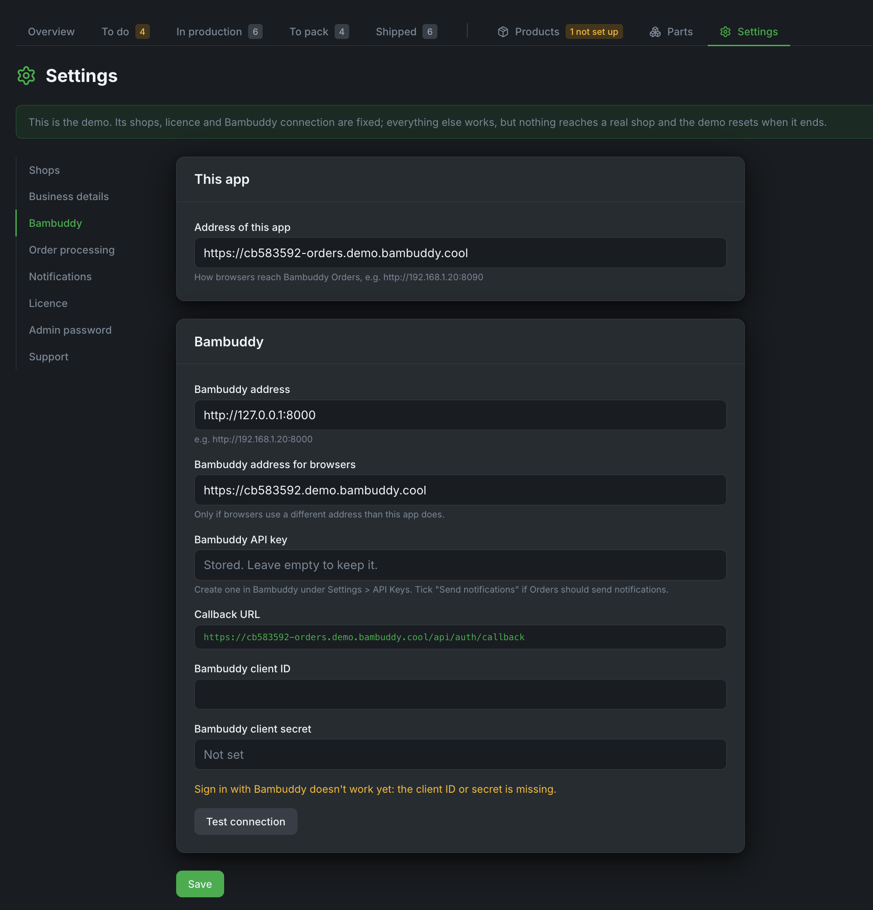
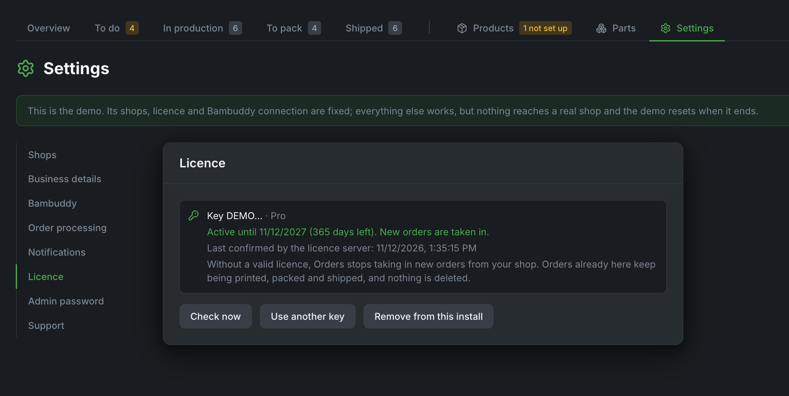

# Installation

About 15 minutes, plus connecting your shops afterwards.

## 1. Sign in to the image registry

Orders' image comes from `registry.bambuddy.cool`. Your licence key is the password:

```bash
docker login registry.bambuddy.cool -u orders
```

Paste the licence key when it asks for the password. Docker remembers the login, so this is needed once per machine.

!!! note
    The registry lets you pull for as long as your licence runs. An expired or withdrawn licence gets a message saying so.

## 2. Start Orders

Make a folder, for example `~/bambuddy-orders`, and save this in it as `docker-compose.yml`:

```yaml
services:
  bambuddy-orders:
    image: registry.bambuddy.cool/bambuddy-orders:latest
    container_name: bambuddy-orders
    ports:
      - "8090:8090"
    environment:
      # Owner of ./data on the host (run `id` to find yours).
      - PUID=1000
      - PGID=1000
    volumes:
      - ./data:/data
    restart: unless-stopped
```

Run `id` and put your user and group numbers into `PUID` and `PGID` if they aren't 1000. Then:

```bash
docker compose up -d
```

## 3. First setup

Open `http://<this machine>:8090`. The setup page asks for:

- an **admin password**, at least 10 characters. It always works, even when Bambuddy is down. Signed in with it, you stay signed in while you use Orders and are signed out after 7 days without; your browser's password manager can save it.
- the **address of Orders** as your browser reaches it, for example `http://192.168.1.20:8090`.
- the **Bambuddy address**, for example `http://192.168.1.20:8000`.
- a **Bambuddy API key**. In Bambuddy, go to **Settings → API Keys** and create a key with **Read Status**, **Manage Queue** and **Send notifications** ticked. An existing key can't be edited there, so make a new one.
- optionally, **Sign in with Bambuddy**, so your team signs in to Orders with their Bambuddy accounts. In Bambuddy, go to **Settings → API Keys → Connected Apps**, add an app with the callback address Orders shows you, and paste its client ID and secret into Orders. Bambuddy's own login must be on for this.

All of these can be changed later under **Settings → Bambuddy**. The screenshot comes from the demo, which runs without Bambuddy's login, so its addresses are the demo's and Sign in with Bambuddy is not set up there.

{ .screenshot }

## 4. Activate the licence

Go to **Settings → Licence**, paste the key and press **Activate**.

{ .screenshot }

Until a licence is active, Orders takes in no orders, and a red line on every page says why. A key runs one installation at a time. To move to another machine, press **Remove from this install** on the old one first, then activate on the new one.

Orders checks the licence about every 6 hours. If our licence server can't be reached, Orders keeps taking in orders for 7 days.

## Updating

When a new version is out, the Overview says so, and **Settings → Support** shows what changed. **Check for updates** there checks at once. To update, in the folder with your `docker-compose.yml`:

```bash
docker compose pull && docker compose up -d
```

Not `docker compose restart`: that keeps the old image. Your data stays in `./data`.

## Backups

Everything Orders keeps is in `./data`. Back up that folder, for example with the rest of your server's backups. Your orders themselves also stay in your shops.

## Coming from the beta

Beta installs pulled `ghcr.io/maziggy/bambuddy-orders:beta`. Switch to the registry: run the `docker login` from step 1 with your beta key, change the `image:` line to `registry.bambuddy.cool/bambuddy-orders:latest`, and run `docker compose pull && docker compose up -d`. Your data and setup stay as they are.
