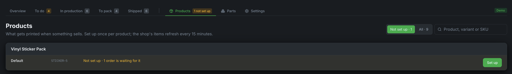
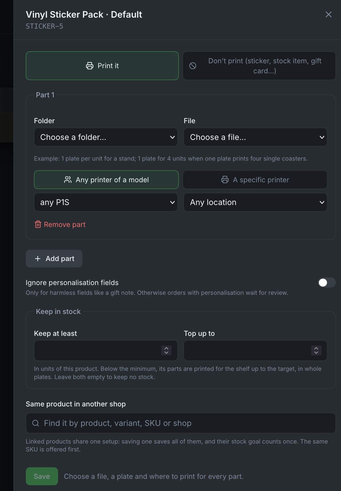
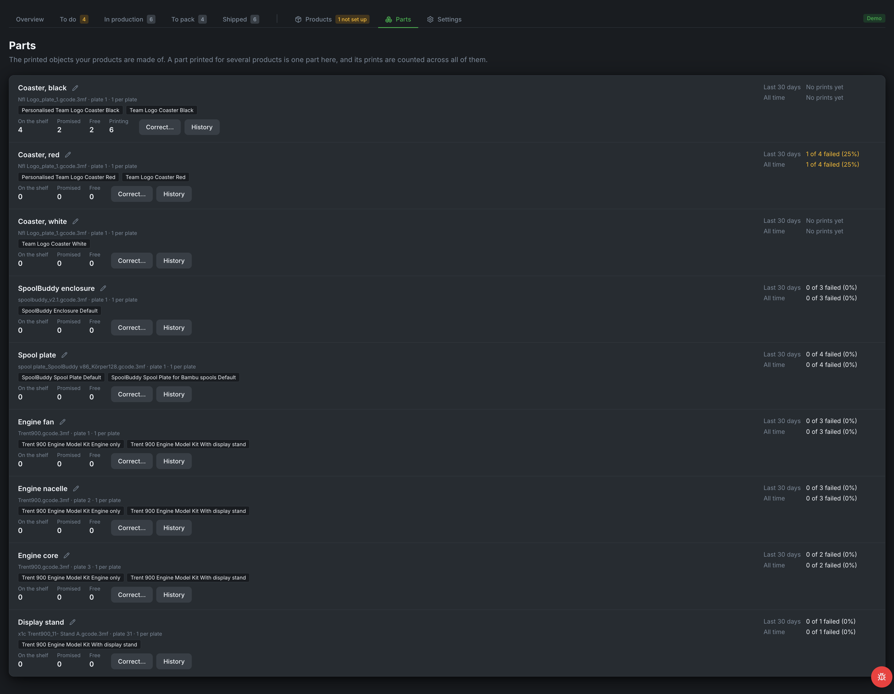

# Products and stock

Orders prints an order only when it knows what to print for each item. That is a product's **setup**, made once per variant under **Products**.

---

## Setting up a product

For each variant you sell, choose:

- the **print file** from Bambuddy's library,
- the **plate** in it,
- how many units a plate holds, or how many plates one unit needs.

Files named like the variant's SKU are suggested automatically. **Search** finds a product by title, variant title or SKU; Products shows 50 at a time.

{ .screenshot }

{ .screenshot }

Products deleted in your shop are listed apart under **Removed from shop**, where their setups can still be looked at or removed.

## Items you don't print

- **Don't print**, set in the product's setup, is for items you never print: stickers, gift cards, items always sold from stock.
- **Don't print for this order**, on an order in **To do**, is for one order whose item you have on hand. The order moves on to **To pack**; the product is not changed.

Personalised items, and items without a setup, always stop in **To do** for you.

## The same product in two shops

A product sold in Shopify and on Etsy is two products in Orders. Link them, and one setup serves both:

- In a product's setup, **Same product in another shop** offers the variant with the same SKU first, and a search finds the rest.
- In a variant not set up yet, **Use the setup of ...** takes over the setup of its twin, which stays as it is.
- The suggestions on **Products** also offer the link when a variant has the SKU of one set up in another shop.

Linked products show as one line with a badge per shop. A change to either is saved for both. A badge's unlink button, or **Unlink** in the setup, separates them again: the one taken out keeps the setup as its own copy, but not the stock goal.

## Parts and the shelf

**Parts** lists the printed parts your products are made of: how many are on the shelf, promised to orders, free and still printing, with corrections, history, and how prints and quality checks went.

Enter your shelf count for a part, and an order the shelf covers goes straight to **To pack**; only what is missing is printed. A part no product uses any more, with nothing on the shelf, promised or printing, can be archived; it comes back by itself as soon as a product uses it again.

{ .screenshot }

## Stock goals

Give a product a stock goal in its setup (**keep at least** / **top up to**). Orders then takes pieces from the shelf first, and top-ups print for the shelf in whole plates. A finished top-up waits in **To do** under **Stock to count** until you enter how many passed your quality check. Linked products count a stock goal once.
