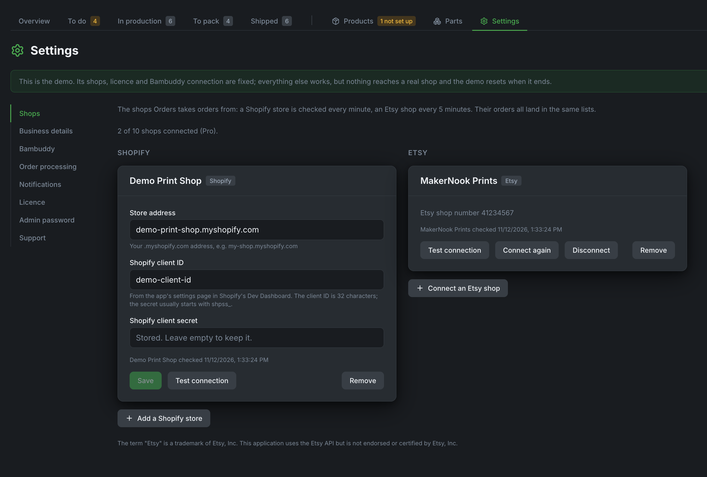

# Connecting shops

Orders takes in orders from any number of Shopify stores and Etsy shops at the same time, up to the number your plan includes (Starter 2, Pro 10, both kinds together). **Settings → Shops** shows how many are connected out of how many.

A disconnected shop keeps its orders and history and frees its place. Connecting a shop beyond your plan is refused with a message saying so; shops already connected are never cut off.

{ .screenshot }

---

## Shopify

Shopify no longer lets you create a "custom app" in the store admin (since 1 January 2026). You create one in Shopify's **Dev Dashboard** instead, and Orders talks to Shopify with that app's client ID and secret. The secret stays on your server.

1. Open [dev.shopify.com/dashboard](https://dev.shopify.com/dashboard) and sign in **with the account that owns your store**.
2. **Apps** → **Create app** → **Start from Dev Dashboard**, name it for example "Bambuddy Orders", **Create**.
3. Open the app's **Versions** page and fill it in:
    - **App URL**: leave the default.
    - **Webhooks API version**: the newest.
    - **Scopes** (Admin API):
        - `read_products`
        - `read_orders`
        - `read_merchant_managed_fulfillment_orders`
        - `write_merchant_managed_fulfillment_orders`

    Then **Release**.
4. On the app's overview, **Install app** (Installs card) → pick **your store** → **Install**.
5. Open the app's **Settings** and copy the **Client ID** and **Client secret**.
6. In Orders, go to **Settings → Shops**, press **Add a Shopify store**, enter your `…myshopify.com` address, the client ID and the secret, and press **Connect**. It should say "Connected to" and your shop's name.

A second store is added the same way, with its own Dev Dashboard app.

!!! warning "Same Shopify organisation"
    Shopify only hands out a token when the app and the store belong to the same Shopify organisation. If connecting fails with an error about the client or the grant, the store probably sits in another organisation, which is common when an agency or partner account created it. Create the app with the account that owns the store.

Orders reads products and paid orders (and pickup orders the buyer pays for at the counter), and marks orders fulfilled when you ship them or the buyer collects them. New orders arrive within about a minute.

## Etsy

Etsy needs no app of your own. Activate your licence first: Orders reaches Etsy through our gateway, which holds our Etsy app's key.

1. In Orders, go to **Settings → Shops**, press **Connect an Etsy shop**, then **Open Etsy to approve**.
2. A Bambuddy page opens in a new tab and shows the address of your Orders. Check that it is yours and press **Continue to Etsy**.
3. Sign in to Etsy with your shop's account and approve. You come back to **Settings → Shops**, which says the shop is connected. Its listings and orders come in with the next check.

Etsy shares one allowance of requests among all sellers, so Orders checks an Etsy shop for new orders every 5 minutes and its listings every hour. **Check now** does both at once.

**What passes through the gateway.** The gateway adds our app's key to each request and passes it on to Etsy, and Etsy's answer back to your Orders. It only allows the requests Orders needs (shop, listings, orders, shipments). Orders pass through without being stored; the gateway only notes which Etsy shop is connected to which licence. Your Etsy access stays encrypted in your installation.

If Etsy stops giving access (you withdrew it on Etsy, or the shop wasn't used for 90 days), Orders says so; press **Connect again**.

The term "Etsy" is a trademark of Etsy, Inc. This application uses the Etsy API but is not endorsed or certified by Etsy, Inc.
